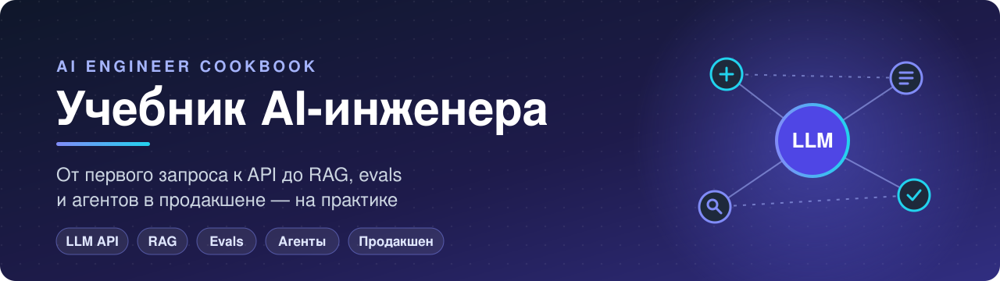

<!-- repo-only:start -->
[Русский](README.md) · **English**

<div align="center">



<br>

[](book/en/README.md)
[](#plan-by-week)
[](#-roadmap)
[](book/en/AIL-2.md)
[](#models-for-study-deepseek--ollama)
<br>
[](site/README.md)
[](LICENSE-CONTENT)
[](LICENSE)

**A course for developers who want to become AI engineers.**<br>
Theory, practice and portfolio projects — on cheap cloud and free local models.

[📖 Contents](book/en/README.md) · [🗺 Course plan](#plan-how-to-become-an-ai-engineer) · [🖥 Study site](https://ai-engineer-cookbook.olgln.workers.dev/en/) · [⚖️ License](#license)

</div>

## ✨ What's inside

- 📚 **Chapters by week** — from Python and the first API request to RAG, evals, agents and production. Every chapter has theory, a learning path, practice, a "Done when" checklist and a quiz with answers.
- 🛒 **One running example** — Shelf, a fictional online shop: its order database, knowledge base and customer messages run through the whole course.
- 🛠 **Four portfolio projects** — an analyst bot, a RAG support assistant, evals with an experiments table and an agent that investigates orders.
- 💸 **Cheap and private** — DeepSeek in the cloud (a few dollars for the whole course) and Ollama locally; customers' personal data never goes to the cloud.
- 🖥 **A study site** — search, quizzes with answer checking, marks for finished chapters and progress by week; starts locally with one command.

## 🧭 Roadmap

| | Stage | Weeks | Result |
|---|---|---|---|
| 🐍 | Python, API, prompting, tool calling | 1–3 | **Project 1:** a "shop analyst" Telegram bot |
| 🔎 | RAG and embeddings | 4–5 | **Project 2:** a support assistant over the knowledge base |
| 📏 | Evals and experiments | 6–7 | **Project 3:** an experiments table in numbers |
| 🤖 | Agents and MCP | 8–9 | **Project 4:** an agent that investigates orders |
| 🚀 | Production | 10 | a cloud and a local model compared: price, quality, latency |

## 🚀 Getting started

**Read on GitHub:** open the [table of contents](book/en/README.md) and start with chapter [1.1 · Python for developers who already code](book/en/AIL-1.md).

**Or run the study site** — it needs Node.js (the version is in `.nvmrc`):

```bash
cd site
npm ci
npm start   # http://127.0.0.1:4321
```

Progress is stored locally and never gets into git; details and settings are in [site/README.md](site/README.md).

## 🗂 Structure

```text
book/          course chapters (AIL-*.md) and the table of contents
book/en/       the English translation of the chapters
site/          the study site: Astro + Starlight, generated from book/
README.en.md   this file: the description and the full course plan
```

---

<!-- repo-only:end -->

# Plan: how to become an AI engineer

<!-- repo-only:start -->
> 📖 The textbook by chapter: [book/en/README.md](book/en/README.md)
>
> 🖥 The local study site (running, settings): [site/README.md](site/README.md)
<!-- repo-only:end -->

> Who it is for: a developer who already programs in some language and knows the basics of git, SQL and the command line. No Python, model or ML experience is required.
> Workload: ~8–10 hours a week → ~4–5 months. **Intensive option: 4 hours a day → ~2.5 months** (see below).
> Principle: 20% theory, 80% projects. Every stage ends with a project worth showing.

## Models for study: DeepSeek + Ollama

The course runs on cheap and free models; Claude and OpenAI stay in the chapters "for comparison".

| What | Where | What for |
|---|---|---|
| **DeepSeek API** (`deepseek-flash`, `deepseek-v4-pro`) | cloud, pennies | the main cloud model; the judge in evals is `deepseek-v4-pro`. **Servers in China: only public texts, the shop's knowledge base and the demo database** |
| **Ollama** (`qwen3:4b` by default, `bge-m3` embeddings) | local, free | customers' personal data, work code and everything private (including the shop database snapshot); embeddings and the reranker. Run with `OLLAMA_NO_CLOUD=1` |
| **OpenRouter** (chapter 2.4) | cloud, one key for many models | comparing models, free `:free` models, fallbacks |
| Claude / OpenAI | cloud | optional, for comparison |

**Hardware** (local models by memory size): 8 GB → 3–4B models; 16 GB → 7–8B; 32 GB and more → 14B and larger. The course targets the minimum: `qwen3:4b` for chat, `bge-m3` for embeddings.

**Privacy:** customers' personal data, work code and anything outsiders must not see never go to cloud models — a local model handles them. The cloud gets public texts, the shop's knowledge base and the demo database. The rule applies to any cloud provider, not only DeepSeek.

**Numbering:** chapters are numbered "week.order" (1.1, 1.2, 2.1 …), as in the [textbook's table of contents](book/en/README.md).

### What to know about DeepSeek and Ollama from day one
- DeepSeek is compatible with the OpenAI SDK: only `base_url`, the key and the model name change. Ollama does the same through `http://localhost:11434/v1`.
- **DeepSeek has no embeddings API** → embeddings and the reranker always run locally (Ollama / sentence-transformers).
- **DeepSeek's cache is automatic** and costs nothing extra; Claude uses an explicit `cache_control`.
- **Structured output:** DeepSeek has only JSON mode (`json_object`), Ollama has a strict schema through `format`.
- **DeepSeek's thinking mode** is on by default: it ignores `temperature`, with tools `reasoning_content` must be sent back, and a forced `tool_choice` returns 400.
- **DeepSeek's price** depends on the hour: off-peak (evenings and weekends UTC) it is half as expensive — a good time for long eval runs.
- Ollama's default context is 4096 tokens and it is silently truncated — RAG and agents need a larger `num_ctx`.
- Facts as of November 2026 — check the current state in the [DeepSeek docs](https://api-docs.deepseek.com) and the [Ollama docs](https://docs.ollama.com).

---

## Intensive schedule: 4 hours a day, 5 days a week

~20 hours a week, ~200 hours in total, **10 weeks**.

### The structure of one day (4 hours)
| Time | What to do |
|---|---|
| 1 hour | Theory: a textbook chapter, docs, videos |
| 2.5 hours | Practice: an exercise or a project (AI generates — we read, fix and ask "why this way") |
| 0.5 hours | Notes: what we understood, what didn't work, questions for tomorrow (the `notes/` folder in the study repository) |

**Friday** — the last hour goes to the weekly review: what is done, what moves on, a commit to GitHub.
**Weekends** — rest. Without them, burnout comes within a month. Long DeepSeek runs fit well on weekends — that is off-peak and cheaper.

### Plan by week
| Week | Chapters | Tasks of the week | Result |
|---|---|---|---|
| 1 | 1.1–1.7 | Mon–Wed: Python to the level of confident reading (differences from a familiar language, `uv`, Pydantic, async), Karpathy's video, **a DeepSeek key, installing Ollama** (with a signature check). Thu–Fri: the raw DeepSeek and Ollama API, tokens, thinking mode, cost | A script that compares answers and the price of a request |
| 2 | 2.1–2.7 | Prompting, structured output (DeepSeek JSON mode vs Ollama `format`), a model overview, **OpenRouter**, tool calling, retries and caching | JSON extraction from 20 texts; the model calls 3 functions |
| 3 | 3.1–3.4 | **Project 1**: a "shop analyst" Telegram bot for the owner on **Ollama** (read-only, a database snapshot); DeepSeek only on the demo database; logging tokens and cost | Project 1 on GitHub |
| 4 | 4.1–4.4 | Embeddings by hand (numpy) with the **local model `bge-m3`**, chunking, sqlite-vec, loading the shop's knowledge base `kb/` | Search over the knowledge base works |
| 5 | 5.1–5.5 | Query rewriting, hybrid search + BM25, a local reranker, a support assistant whose answers link to the knowledge base section (generation by DeepSeek); a LlamaIndex version | **Project 2** on GitHub |
| 6 | 6.1–6.5 | Articles on evals, synthetic questions, a set of 50–100 questions, an evaluation script (the judge is `deepseek-v4-pro`), Langfuse Cloud / promptfoo | Evals give the first number |
| 7 | 7.1–7.5 | Eval statistics, experiments: chunking A/B, **`qwen3:4b` vs `deepseek-flash`**, with and without a reranker; manual error analysis | **Project 3** (an experiments table) |
| 8 | 8.1–8.5 | "Building effective agents", workflow patterns, an agent loop by hand, prompt injection, our own MCP server (read-only, Ollama as the host) | An MCP server for the shop database (read-only) |
| 9 | 9.1–9.4 | Agent memory, an agent that investigates orders (Ollama on the database snapshot with customer data, DeepSeek only on the demo database), frameworks, evals on 20 cases | **Project 4** on GitHub |
| 10 | 10.1–10.5 | Docker, DeepSeek vs Claude caching, budgets (the DeepSeek balance), a DeepSeek → OpenRouter → Ollama fallback, tracing and the cost of an answer, our own evals on a local model, a LoRA example | A cloud and a local model compared in numbers |

### Checkpoints
- **End of week 3** — the first project works and is on GitHub. If not, cut theory, but don't skip the project.
- **End of week 7** — there are numbers from evals. This is the main artifact for job interviews.
- **End of week 10** — 4 projects and a cloud vs local model comparison in numbers.

### Budget
- DeepSeek: the whole course costs a few dollars (an estimate; a run of 60 eval questions ≈ $0.30–0.60). It is worth topping up the balance in small amounts — at zero the API returns 402, and that is the spending cap.
- Ollama, sentence-transformers, sqlite-vec, promptfoo: free.
- Claude / OpenAI: optional, $5–10 for comparisons at the end of the course.

---

## Who an AI engineer is (in short)

A developer who builds products **on top of ready-made models** (GPT, Claude, Gemini, DeepSeek, Qwen, Llama): integrates LLMs into applications, builds RAG and agents, measures quality (evals) and takes it all to production — keeping cost, latency, privacy and security under control. This is software engineering first, not math. Working with different providers and comparing them on our own evals is a plus of its own.

- The article that gave the profession its name: [The Rise of the AI Engineer — swyx, Latent Space](https://www.latent.space/p/ai-engineer)

---

## Stage 0. Preparation (1–2 weeks)

### What to do
- [ ] Bring **Python** up to confident reading: types, `async/await`, virtual environments, `uv`, `pydantic`.
- [ ] Get a [DeepSeek](https://platform.deepseek.com) key and top it up with $2–5.
- [ ] Install [Ollama](https://ollama.com) only from the official site (on macOS, check the signature before the first launch: `codesign -dv` and `spctl -a -vv`; for other systems, follow the official instructions). Download `qwen3:4b` and `bge-m3`.
- [ ] (For comparison, optional) keys for the [Anthropic Console](https://console.anthropic.com) and the [OpenAI Platform](https://platform.openai.com).
- [ ] Watch [Intro to Large Language Models — Andrej Karpathy](https://www.youtube.com/watch?v=zjkBMFhNj_g) (1 hour).
- [ ] (Optional) [Neural Networks — 3Blue1Brown](https://www.youtube.com/playlist?list=PLZHQObOWTQDNU6R1_67000Dx_ZCJB-3pi) — visual intuition for how neural networks and transformers work.

### Resources
- [The official Python tutorial](https://docs.python.org/3/tutorial/)
- [uv — a fast Python package manager](https://docs.astral.sh/uv/)
- [Pydantic](https://docs.pydantic.dev) — data validation, needed almost everywhere in LLM code
- [DeepSeek API docs](https://api-docs.deepseek.com) — quick start, pricing, thinking mode
- [Ollama docs](https://docs.ollama.com) — installing on macOS, OpenAI compatibility

---

## Stage 1. LLM basics (3–4 weeks)

### What to learn
- Tokens, the context window, `temperature`, `top_p`, the system prompt; thinking mode (reasoning) and how it changes the parameters.
- Prompting: roles, few-shot examples, XML/Markdown structure, chain-of-thought.
- **Structured output** — the model returns valid JSON that matches a schema (DeepSeek: JSON mode; Ollama: `format` with a schema; Claude/OpenAI: strict schemas).
- **Tool calling** — the model calls our functions.
- Streaming responses, retries, rate limits (DeepSeek limits concurrent requests), calculating the cost of a request with caching and peak hours taken into account.
- **Prompt caching** — automatic in DeepSeek, explicit in Claude.
- **OpenRouter** — one API for many models, comparing models.

### Plan by week
| Week | Topic | Exercise |
|---|---|---|
| 1 | The raw DeepSeek and Ollama API, parameters, cost | A script: one question with different settings, counting tokens and price (with and without caching) |
| 2 | Prompting, structured output, OpenRouter | Extract JSON matching a Pydantic schema from 20 unstructured texts; one task through 4–5 OpenRouter models |
| 3 | Tool calling | The model calls 2–3 functions (exchange rate, calculator, time) |
| 4 | The stage project | See below |

### Resources
- [DeepSeek API docs](https://api-docs.deepseek.com) — JSON mode, function calling, thinking mode, context caching
- [Ollama docs](https://docs.ollama.com) — structured outputs, tool calling
- [OpenRouter docs](https://openrouter.ai/docs) — quickstart, free models, fallbacks
- [Anthropic: Prompt engineering overview](https://docs.anthropic.com/en/docs/build-with-claude/prompt-engineering/overview) — the best prompting guide, works for any model
- [Anthropic Courses on GitHub](https://github.com/anthropics/courses) — interactive notebooks on prompting and tool use
- [OpenAI Cookbook](https://cookbook.openai.com)
- [DeepLearning.AI Short Courses](https://www.deeplearning.ai/short-courses/) — free courses of 1–2 hours each
- [Instructor](https://python.useinstructor.com) — structured output on top of Pydantic (for DeepSeek, the `MD_JSON` mode)
- [Vercel AI SDK](https://ai-sdk.dev) — the same in TypeScript

### Project 1: a "shop analyst" Telegram bot
- A bot for the owner of the online shop Shelf answers questions about orders and sales ("what's the revenue for the week", "which orders haven't shipped yet", "how much interest is there in the Light Lamp").
- Through tool calling the model calls **read-only** functions only: `get_open_orders`, `get_sales`, `get_product_interest`, `get_recent_orders`.
- ⚠️ No functions that change an order, issue a refund or hand out a promo code. Work on a database snapshot (`VACUUM INTO`).
- 🔒 **The database snapshot holds customers' personal data — only the local Ollama model** (`qwen3:4b`). DeepSeek and other cloud models work only on the demo database without personal data. The data policy check lives right in the code.
- Log every request: tokens, cost, response time.

---

## Stage 2. RAG and embeddings (3–4 weeks)

### What to learn
- Embeddings, cosine similarity. **Embeddings run locally** (Ollama `bge-m3` or sentence-transformers): DeepSeek has none.
- Chunking: by size, by document structure, with overlap.
- Vector databases: start with [sqlite-vec](https://github.com/asg017/sqlite-vec) (the familiar SQLite) or [pgvector](https://github.com/pgvector/pgvector); take a look at [Qdrant](https://qdrant.tech).
- Query rewriting, hybrid search (vector + BM25), **reranking** (a local cross-encoder — neither DeepSeek nor Ollama has a rerank endpoint).
- Answer generation by DeepSeek (the shop's knowledge base is public and can be sent; real customers' messages stay local only).
- Typical reasons why RAG goes wrong and how to fix them.

### Plan by week
| Week | Topic | Exercise |
|---|---|---|
| 1 | Embeddings | Compute embeddings of 100 phrases with a local model, find the nearest ones by hand (numpy) |
| 2 | Chunking + a vector database | Load the shop's knowledge base, compare 3 chunking strategies |
| 3 | Hybrid search, reranking | Add BM25 and a local reranker, compare the results |
| 4 | The stage project | See below |

### Resources
- [Anthropic: Contextual Retrieval](https://www.anthropic.com/news/contextual-retrieval) — an excellent article on improving RAG (works on DeepSeek thanks to the automatic cache)
- [Sentence Transformers](https://sbert.net) — local embeddings and rerankers
- [Ollama: embeddings](https://docs.ollama.com) — `/api/embed`, watch out for `truncate`
- [LlamaIndex docs](https://docs.llamaindex.ai) — a RAG framework (after the hand-built version)
- [Hugging Face Learn](https://huggingface.co/learn) — courses on NLP and models

### Project 2: a support assistant over the shop's knowledge base
- Build the shop's knowledge base `kb/` (delivery, payment, returns, warranty, promo codes, products) — Markdown pages, the source of truth.
- The assistant answers customers' questions ("can I return opened tea?", "what's the warranty on LAMP-LIGHT-MINI?") **with a link to the knowledge base section**; if the base has no answer, it says so honestly and hands the question to a human.
- Embeddings and the reranker run locally, generation on DeepSeek; it also works fully offline on Ollama.
- Version 1 — no frameworks, by hand. Version 2 — on LlamaIndex. Compare them.

---

## Stage 3. Evals — measuring quality (2–3 weeks) ⭐ the most important

### What to learn
- How to build a test set: question → reference answer / criteria.
- RAG metrics: retrieval (was the right chunk found), faithfulness (did it make anything up), answer relevance.
- **LLM-as-judge** and its limits (bias, instability, a preference for "its own"). The judge is a model stronger than the one under test: `deepseek-v4-pro` without thinking mode; a local 4B model is no good as a judge.
- Statistics: noise, sample size, when an improvement is real.
- Regression testing: changed the prompt/model → ran it → compared.
- Manual error analysis: read the real answers, don't just look at the numbers.

### Resources
- [Hamel Husain: Your AI Product Needs Evals](https://hamel.dev/blog/posts/evals/) — a must-read
- [Hamel Husain — blog](https://hamel.dev) — lots of practice on evals
- [Eugene Yan — blog](https://eugeneyan.com) — LLM system patterns, evals
- [Langfuse](https://langfuse.com) — tracing and evals; with 8 GB of memory Langfuse Cloud is simpler (only for public data: the knowledge base and the question set), self-hosting needs more resources
- [promptfoo](https://www.promptfoo.dev) — testing prompts from the command line, with `deepseek:` and `ollama:` providers

### Project 3: evals and experiments for the support assistant
- [ ] A set of 50–100 customer questions with reference answers (including traps: archived return rules, similar products, questions the base has no answer to).
- [ ] A script that outputs a score (retrieval + answer quality) and the cost of the run.
- [ ] An experiments table: "chunking A vs B", "`qwen3:4b` vs `deepseek-flash`", "with / without a reranker" — with numbers for quality, cost and latency.
- This is the main material for the portfolio and job interviews.

---

## Stage 4. Agents (4 weeks)

### What to learn
- The agent loop: think → call a tool → look at the result → repeat.
- Workflow vs agent: when a simple pipeline is enough (most of the time).
- **MCP (Model Context Protocol)** — write our own MCP server; the host for the database snapshot with customer data is a bridge to Ollama.
- Frameworks: LangGraph, OpenAI Agents SDK, Claude Agent SDK — and how they work with DeepSeek and Ollama.
- The weak spots of small local models in agents: 3–5 simple tools, flat schemas, a step limit, checks in code.
- Security: prompt injection, least-privilege tools, human confirmation of dangerous actions; a cloud provider is a data leak channel too.

### Resources
- [Anthropic: Building effective agents](https://www.anthropic.com/engineering/building-effective-agents) — a must-read
- [Model Context Protocol — documentation](https://modelcontextprotocol.io)
- [MCP servers — examples on GitHub](https://github.com/modelcontextprotocol/servers)
- [LangGraph](https://langchain-ai.github.io/langgraph/)
- [OpenAI Agents SDK](https://openai.github.io/openai-agents-python/) — works with any OpenAI-compatible API, including DeepSeek and Ollama
- [OWASP Top 10 for LLM Applications](https://genai.owasp.org/llm-top-10/) — the main vulnerabilities of LLM applications

### Project 4: an agent that investigates orders
- An MCP server for the shop database: **read-only** (orders, payments, deliveries, products, the order event log).
- Asked "what happened to order 1042?", the agent itself checks payments, delivery and the event log and writes an analysis with evidence: a double charge, a stuck delivery, a promo code that wasn't applied, a refund that never arrived.
- 🔒 The database snapshot with customer data goes only to Ollama; DeepSeek works only on the generated demo database.
- Evals for the agent: 20 cases with a known cause (the judge is code + a manual check + a local model: a cloud judge would see customers' personal data).

---

## Stage 5. Production (3–4 weeks)

### What to learn
- Caching: DeepSeek's automatic cache (the `prompt_cache_hit_tokens` / `prompt_cache_miss_tokens` fields) vs Claude's explicit `cache_control`; cost control, budgets (the DeepSeek balance, `402` at zero).
- Observability: tracing every call, a quality and cost dashboard.
- Fallbacks: DeepSeek → OpenRouter → Ollama (private requests never go to the cloud), through our own wrapper, LiteLLM or OpenRouter; timeouts, degradation.
- Local models: [Ollama](https://ollama.com), [vLLM](https://docs.vllm.ai), quantization; Ollama on macOS runs natively, and containers reach it through `host.docker.internal`.
- Fine-tuning and LoRA — understand **when** it is needed (rarely), be able to run a basic example. DeepSeek has no fine-tuning.

### Resources
- [Hugging Face: PEFT / LoRA](https://huggingface.co/docs/peft)
- [LiteLLM](https://docs.litellm.ai) — a single interface and fallbacks (pin the version, check the package)
- [Simon Willison — blog](https://simonwillison.net) — practice, news, tools, LLM security
- [LLM CLI by Simon Willison](https://llm.datasette.io) — a handy tool for experiments

### What to do
- [ ] Run our own evals on a local model and on DeepSeek, compare quality, speed and price.
- [ ] A DeepSeek → OpenRouter → Ollama fallback with a privacy flag.
- [ ] Add tracing (Langfuse) and calculate the cost of one answer with caching and peak hours taken into account.

---

## Ongoing reading

### Books
- [Chip Huyen — AI Engineering (O'Reilly, 2025)](https://www.oreilly.com/library/view/ai-engineering/9781098166298/) — the best overview book on the profession

### Blogs and newsletters
- [Anthropic Engineering](https://www.anthropic.com/engineering)
- [DeepSeek API News / Changelog](https://api-docs.deepseek.com) — model and price changes
- [Simon Willison](https://simonwillison.net)
- [Hamel Husain](https://hamel.dev)
- [Eugene Yan](https://eugeneyan.com)

### Podcasts
- [Latent Space](https://www.latent.space) — the main podcast about AI Engineering

### Going deeper (optional)
- [Karpathy — Neural Networks: Zero to Hero](https://karpathy.ai/zero-to-hero.html) — building GPT from scratch
- [fast.ai — Practical Deep Learning](https://course.fast.ai) — a practical deep learning course

---

## Key rules

1. **Build, don't just watch courses.** 20% theory, 80% projects.
2. **Frameworks come later.** The raw API first → then LangChain/LlamaIndex.
3. **Always measure.** A project with evals is worth far more than "it works, I checked by hand".
4. **Build on our own domain.** Domain knowledge + AI is a strong niche.
5. **Safe by default.** Agents get read-only access until there is human confirmation. No changes to orders, refunds or promo codes without a human.
6. **Private by default.** Customers' personal data, work code and everything private stay local only (Ollama). The cloud (DeepSeek and any free tiers) gets only public texts, the knowledge base and the demo database.
7. **Don't get locked into a provider.** One OpenAI-compatible client, the model and `base_url` in settings; compare models on our own evals.

---

## Progress tracker

| Stage | Started | Finished | Project on GitHub |
|---|---|---|---|
| 0. Preparation | | | — |
| 1. LLM basics | | | |
| 2. RAG | | | |
| 3. Evals | | | |
| 4. Agents | | | |
| 5. Production | | | |

---

## License

- **The course text** — the chapters in `book/`, this plan, the quizzes and the assignments — is distributed under the [CC BY-NC-SA 4.0](https://creativecommons.org/licenses/by-nc-sa/4.0/) license: the materials may be read, copied, translated and adapted with attribution and a link to the license, adaptations go under the same license, and commercial use (paid courses, selling the materials) needs the authors' permission. The full terms are in the repository's `LICENSE-CONTENT` file.
- **The code** — the site in `site/` and the code examples in the chapters — is under the [MIT](https://opensource.org/license/mit) license (the `LICENSE` file): the examples may be freely moved into personal and work projects, including commercial ones, as long as the copyright notice is kept.
