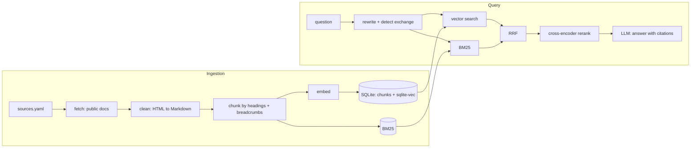

# 5.5 · Проект 2: README и GitHub  (AIL-25)

> **Неделя 5** · RAG · ⏱ ~4 ч · Проект

## Зачем это AI-инженеру

Это второй проект в портфолио. Нанимающий менеджер тратит на репозиторий 2–5 минут: читает README, смотрит схему и цифры, иногда пробует запустить. Проект без README и без цифр качества выглядит как учебный ноутбук; проект с таблицей «вектор / гибрид / гибрид + реранкер», честным разделом об ограничениях и запуском в три команды выглядит как работа инженера. На собеседовании этот README — твой конспект для рассказа о проекте.

## Теория

### Кто читает README и что ищет

| Читатель | Время | Что ищет |
|---|---|---|
| Рекрутер / HR | 30 секунд | Что это, стек, есть ли демо (скриншот/GIF) |
| Нанимающий инженер | 3–5 минут | Архитектура, решения и их обоснование, цифры качества, код-стиль, тесты |
| Ты на собеседовании | — | Готовая история: проблема → решения → измерения → выводы |
| Ты через полгода | 10 минут | Как это запустить |

Отсюда порядок: сначала **что и зачем** (с картинкой), потом **как работает и насколько хорошо**, потом **как запустить**, в конце детали.

### Структура README

```
# Exchange Docs RAG
Одна фраза: что это. Скриншот или GIF.

## Problem                 — зачем: доки 4 бирж, вопросы на русском, нужны точные ссылки
## Demo                    — 3–4 примера вопрос → ответ со ссылками (+ один отказ)
## Architecture            — схема (Mermaid), две фазы: ingestion и query
## How retrieval works     — chunking, гибрид, фильтры, реранкер: по абзацу, с «почему»
## Results                 — golden set, таблицы метрик, что дало каждое улучшение
## Manual vs LlamaIndex    — из AIL-24
## Quickstart              — от git clone до первого ответа
## Project structure       — дерево с одной строкой на файл
## Evaluation              — как перепрогнать eval
## Limitations & next steps— честно
## License / Disclaimer
```

README можно писать по-английски (так шире аудитория) — решай сам; главное, чтобы он был последовательным. Если пишешь по-русски, имена файлов, команды и метрики всё равно остаются как есть.

### Раздел Results — сердце README

Цифры отличают инженерный проект от демо. Покажи:

- **Как устроен golden set**: 20 вопросов, какие типы (жаргон, без биржи, точные идентификаторы, сравнительные), как определяется «правильный кусок».
- **Таблицу поиска** (из AIL-19, AIL-60, AIL-22) — путь улучшений, а не только финальную цифру:

  | Конфигурация | hit@3 | hit@5 | MRR | p50, мс |
  |---|---|---|---|---|
  | baseline: вектор, fixed chunks | | | | |
  | + chunking по заголовкам | | | | |
  | + rewrite + фильтр биржи | | | | |
  | + BM25 (RRF) | | | | |
  | + реранкер | | | | |

- **Таблицу ответов** (AIL-23): корректные / с цитатами / уместные отказы.
- **Честную оговорку**: 20 вопросов — маленькая выборка, разница в 1–2 вопроса — шум.

Не подгоняй цифры и не убирай «неудобные» строки: «реранкер не помог на вопросах с кодами ошибок, потому что…» — сильнее, чем идеальная таблица. Это то, о чём тебя спросят.

### Схема архитектуры

GitHub рендерит Mermaid прямо в Markdown — схема хранится текстом, её легко менять, она видна в диффах:

````markdown

````

Возьми за основу схему из своих `notes/rag.md` (AIL-59) и обнови её по факту — что-то наверняка изменилось.

### Воспроизводимость: «можно запустить с нуля»

Критерий готовности задачи — **проект запускается по README в чистом окружении**. Что для этого нужно:

1. **Зафиксированные зависимости.** `requirements.txt` с точными версиями (`pip freeze` после проверки, или `pyproject.toml` + lock-файл, если используешь `uv`/poetry). Указанная версия Python.
2. **`.env.example`** — список переменных без значений:
   ```
   ANTHROPIC_API_KEY=
   OPENAI_API_KEY=        # only if you use OpenAI embeddings
   EMBED_MODEL=
   REWRITE_MODEL=
   ANSWER_MODEL=
   RERANK_MODEL=
   ```
   Пользователь копирует в `.env` и заполняет. Реальный `.env` — в `.gitignore`.
3. **Скрипт загрузки документации** — индекс и сырые HTML **не коммитятся**: они большие, пересобираемые, а сам текст документации принадлежит биржам. В репозитории — код, который их скачивает (`ingest.py`), и `sources.yaml`.
4. **Одна точка входа на действие**: `make ingest`, `make ask Q="..."`, `make eval`, `make app`, `make test` — или эквивалентные короткие команды в README. Makefile тебе знаком по сути: это как `scripts` в `package.json`.
5. **Ожидаемое время и стоимость**: «индексация 4 бирж: ~N минут, ~$X за эмбеддинги при API-модели (или бесплатно с локальной)».
6. **Офлайн-тесты** запускаются без ключей и сети: `pytest` проходит на чистом клоне.
7. **Проверка «с нуля»**: клонируешь репозиторий в новую папку, создаёшь новый venv, идёшь строго по README. Каждая заминка — правка README.

### Гигиена публичного репозитория

- **Секреты.** Перед первым push проверь не только текущие файлы, но и **всю историю коммитов**: ключ, однажды закоммиченный и потом удалённый, остаётся в истории. Инструмент — например, [gitleaks](https://github.com/gitleaks/gitleaks) (`gitleaks detect` по репозиторию). Если ключ утёк — **отзови его у провайдера** немедленно, переписывание истории не спасает (его уже могли увидеть).
- **`.gitignore`**: `.env`, `.venv/`, `index.db*`, `raw/`, `cache/`, `__pycache__/`, `.DS_Store`, persist-папки LlamaIndex.
- **Никаких личных данных и ничего из торгового приложения.** Этот проект работает только с публичной документацией; в нём нет и не должно быть ключей бирж, путей к твоей торговой базе, твоих сделок, логов или токена торгового Telegram-бота. Если в примерах нужны «данные пользователя» — они выдуманные.
- **Disclaimer**: проект не аффилирован с биржами, ответы могут быть неточными, проверяйте по ссылкам; это не финансовый совет.
- **Лицензия** на твой код (MIT — частый выбор для портфолио); документация бирж — не твоя, и ты её не распространяешь.
- **Чистая история коммитов**: осмысленные сообщения. Не нужно 50 коммитов «fix».

### Что добавляет очков (опционально)

- **Скриншот или GIF** интерфейса из AIL-23 в начале README.
- **CI**: GitHub Actions, запускающий `pytest` (офлайн-тесты) на каждый push — зелёный бейдж показывает, что тесты реальные.
- **Раздел «Design decisions»**: почему sqlite-vec, почему chunking по заголовкам, почему отказ фиксированной фразой — 1–2 предложения на решение.
- **Пример вывода eval** в `eval/RESULTS.md`, ссылка из README.

### Раздел Limitations

Честные ограничения показывают зрелость. Примеры для твоего проекта: 4 биржи и только часть разделов; индекс обновляется вручную; golden set из 20 вопросов написан автором (риск подгонки); оценка ответов ручная; нет учёта версий API; ответы только по тексту — без проверки на живом API. И next steps: автоматический eval с LLM-судьёй, обновление по расписанию, больше бирж, contextual retrieval на всём индексе.

## DeepSeek и Ollama: как это сделать у нас

Для README провайдер важен в четырёх местах.

1. **`.env.example` под наш стек.** Вместо переменных из «Теории»:
   ```
   ANSWER_PROVIDER=deepseek      # deepseek | ollama | anthropic (comparison)
   DEEPSEEK_API_KEY=
   ANSWER_MODEL=                 # e.g. deepseek-flash; check api-docs.deepseek.com
   REWRITE_MODEL=
   OLLAMA_BASE_URL=http://localhost:11434
   ANSWER_MODEL_LOCAL=           # e.g. qwen3:4b, for the offline mode (fits an 8 GB Mac)
   EMBED_BACKEND=ollama          # ollama | st
   EMBED_MODEL=                  # e.g. bge-m3
   RERANK_MODEL=                 # local cross-encoder, e.g. BAAI/bge-reranker-v2-m3
   ANTHROPIC_API_KEY=            # optional, comparison runs only
   ```
2. **Quickstart с Ollama.** Добавь шаги «установить Ollama с ollama.com (macOS 14+), `ollama pull bge-m3` (и локальную LLM для офлайн-режима)» и честные требования: сколько места на диске и памяти занимают модели (например, «офлайн-режим проверен на M2 с 8 GB с моделью класса 4B; модели 7–8B требуют больше свободной памяти») и что без запущенной Ollama `ingest` не работает. Режим «полностью офлайн» (Ollama для эмбеддингов и ответов) — сильный пункт для README: проект можно запустить без единого ключа.
3. **Стоимость и время.** «Индексация: бесплатно, локальные эмбеддинги, ~N минут на M-чипе. Ответ: ~$X за вопрос на `deepseek-flash`, посчитано по `usage` (дата, цены с [api-docs.deepseek.com](https://api-docs.deepseek.com/quick_start/pricing)); в пиковые часы DeepSeek вдвое дороже». Укажи дату — цены и имена моделей меняются.
4. **Куда уходят данные.** Один абзац в README: при `ANSWER_PROVIDER=deepseek` вопросы и найденные куски документации отправляются в API DeepSeek (серверы в Китае); эмбеддинги и реранкинг локальные; для приватных вопросов есть режим Ollama. Для проекта по публичной документации это нормально, но читатель (и интервьюер) должен это видеть — это показывает, что ты думаешь о данных.

В разделе Results укажи, **какие модели** дали цифры (бэкенд и модель эмбеддингов, реранкер, генератор, дата) и, если делал, строки сравнения DeepSeek / Ollama / Claude из глав 5.1 и 5.3. Таблица «одинаковый пайплайн, разные генераторы» — хорошая тема на собеседовании.

| Что важно для README | Claude | OpenAI | DeepSeek | Ollama |
|---|---|---|---|---|
| Нужен ключ | Да | Да | Да (`DEEPSEEK_API_KEY`) | Нет |
| Что указать в Quickstart | Ключ | Ключ | Ключ, имя модели | Установка, `ollama pull`, место на диске |
| Стоимость | За токены | За токены | За токены, кэш-попадания дешевле, пиковые часы дороже | Бесплатно, время и память Mac |
| Пометка о данных | Облако США | Облако США | Облако в Китае — явно написать | Локально |

## Маршрут изучения

1. Открой [GitHub Docs: About READMEs](https://docs.github.com/en/repositories/managing-your-repositorys-settings-and-features/customizing-your-repository/about-readmes) (≈10 мин). Вынеси: где GitHub ищет README, как работают относительные ссылки и якоря заголовков.
2. Открой [GitHub Docs: Creating diagrams](https://docs.github.com/en/get-started/writing-on-github/working-with-advanced-formatting/creating-diagrams) → раздел про Mermaid (≈15 мин). Набросай схему и проверь её в предпросмотре GitHub или в Mermaid Live Editor.
3. Открой README двух-трёх известных RAG/LLM-репозиториев на GitHub (например, [rank_bm25](https://github.com/dorianbrown/rank_bm25), [sqlite-vec](https://github.com/asg017/sqlite-vec)) и посмотри, как устроены quickstart и примеры (≈20 мин). Возьми идеи структуры, не тексты.
4. Открой [gitleaks](https://github.com/gitleaks/gitleaks) → README: установка и `detect` по локальному репозиторию (≈15 мин). Это сторонний инструмент: по твоему правилу проверь источник установки (официальная формула brew / релиз из GitHub с проверкой) прежде чем ставить.
5. (Опционально) Документация GitHub Actions: quickstart для Python — workflow, который ставит зависимости и запускает `pytest` (≈20 мин).
6. Сверь в README имена моделей и цены с [DeepSeek: Models & Pricing](https://api-docs.deepseek.com/quick_start/pricing), а системные требования Ollama — с [Ollama: macOS](https://docs.ollama.com/macos) (≈10 мин). Запиши дату проверки рядом с цифрами.

## На что обратить внимание

- **README не совпадает с кодом**: команды переименованы, переменные окружения добавлены, а README устарел. Единственная защита — прогон «с нуля» в конце.
- **Ключ в истории git** — самая дорогая ошибка; проверяй историю, не только последний коммит.
- **Закоммиченный индекс / сырые HTML** — раздувает репозиторий и распространяет чужой контент.
- **Тесты, требующие сети или ключей**, падают у любого, кто склонировал. Разделяй офлайн-тесты и eval, который ходит в API.
- **Цифры без методики** («точность 95%») вызывают недоверие. Всегда: на каком наборе, сколько вопросов, как считали.
- **Абсолютные пути** (`/Users/...`) в коде или README — у других людей их нет. Только относительные пути и переменные окружения.
- **Захардкоженные имена моделей** в коде — вынеси в `.env`, модели меняются.
- **Публикация — твоё решение.** Перед push пройди чек-лист ниже; репозиторий можно сначала создать приватным и сделать публичным, когда всё проверено.

## Практика

- [ ] **Уборка.** Удали мёртвый код и экспериментальные ноутбуки, которые не нужны (или перенеси в `experiments/` с пометкой). Имена моделей и пути — из `.env`/конфига.
- [ ] **Зависимости.** `requirements.txt` (или `pyproject.toml` + lock) с точными версиями; отдельно `requirements-llamaindex.txt`, если LlamaIndex-версия живёт в том же репо. В README указана версия Python.
- [ ] **`.env.example`** со всеми переменными (вариант для DeepSeek + Ollama из раздела выше); `.gitignore` по списку из теории.
- [ ] **Ollama в Quickstart**: шаги установки, `ollama pull` нужных моделей, место на диске, режим «без ключей» (всё на Ollama). Абзац «Куда уходят данные».
- [ ] **Точки входа.** `Makefile` (или раздел команд в README): `setup`, `ingest`, `ask`, `app`, `eval`, `test`.
- [ ] **README** по структуре из теории:
  - [ ] одна фраза + скриншот/GIF;
  - [ ] Problem;
  - [ ] Demo: 3–4 реальных вопроса из golden set с ответами и ссылками + 1 отказ;
  - [ ] Architecture: Mermaid-схема двух фаз;
  - [ ] How retrieval works: chunking, фильтр биржи, гибрид + RRF, реранкер — по абзацу с «почему»;
  - [ ] Results: методика golden set, таблица пути улучшений поиска, таблица ответов, оговорка про размер выборки;
  - [ ] Manual vs LlamaIndex (из AIL-24);
  - [ ] Quickstart; Project structure; Evaluation; Limitations & next steps; License; Disclaimer.
- [ ] **Проверка секретов.** `git log -p | grep -iE "api_key|sk-|token"` как быстрый взгляд и полноценная проверка gitleaks по всей истории. Убедись, что `.env`, `index.db`, `raw/` не отслеживаются (`git ls-files`).
- [ ] **Прогон с нуля.** `git clone` в новую папку → новый venv → строго по README: `setup` → заполнить `.env` → `ingest` → `ask` → `app` → `test`. Записывай каждую заминку и правь README. Повтори, пока не пройдёт без единого вопроса.
- [ ] **(Опционально) CI.** `.github/workflows/test.yml`: офлайн `pytest` на push; бейдж в README.
- [ ] **Push на GitHub.** Создай репозиторий (можно сначала приватным), push, открой страницу на GitHub и проверь: схема Mermaid рендерится, ссылки и картинки работают, таблицы читаются. Затем сделай публичным.
- [ ] **Питч.** В конце README или в своих заметках — 5 предложений, как ты рассказываешь проект на собеседовании: проблема, архитектура, самое полезное улучшение (с цифрой), главный урок, что сделал бы дальше.

## Готово, когда

- Проект запускается по README с нуля в чистом клоне и новом окружении: от `git clone` до ответа со ссылками без единой неописанной команды.
- В README есть схема архитектуры, описание поиска, примеры вопросов и ответов, цифры качества с методикой, сравнение с LlamaIndex и ограничения.
- Скрипт загрузки документации и инструкция по запуску на месте; индекс и сырые доки не в репозитории.
- В репозитории и его истории нет секретов и ничего из торгового приложения; проект запушен на GitHub.

## Тест для самопроверки

1. Назови порядок основных разделов README и объясни, почему «как запустить» не идёт первым.
2. Почему индекс (`index.db`) и скачанные HTML не стоит коммитить? Две причины.
3. Ты закоммитил `.env` с ключом, потом удалил его следующим коммитом и запушил. Достаточно ли этого? a) да, файла больше нет b) нет: ключ в истории; нужно отозвать ключ у провайдера c) достаточно сделать репозиторий приватным d) достаточно `git rm --cached .env`
4. Зачем `.env.example`, если есть `.env`?
5. Что не так в этом фрагменте README?
   ```
   ## Results
   Accuracy: 95%. The system works great.
   ## Quickstart
   cd /Users/me/projects/rag && python ingest.py
   ```
6. Почему в Results стоит показать путь улучшений, а не только финальную цифру?
7. Чем Mermaid-схема в README лучше картинки PNG?
8. Как проверить, что проект «запускается с нуля»?
9. Почему офлайн-тесты не должны требовать ключей и сети?
10. Что написать в Limitations для твоего проекта? Назови три пункта.
11. Почему в демо и примерах нельзя использовать данные из твоего торгового приложения?
12. Почему в README проекта на DeepSeek стоит отдельно написать, куда уходят данные, и что там должно быть?
13. Как сделать так, чтобы проект можно было запустить вообще без облачных ключей? a) никак b) режим, где эмбеддинги, реранкер и генерация — локальные (Ollama + Sentence Transformers), выбирается переменными окружения c) закоммитить свой ключ DeepSeek d) использовать бесплатный тариф любого облака

## Ответы

1. Что и зачем (с картинкой) → демо → архитектура → как работает поиск → результаты → сравнение → quickstart → структура → eval → ограничения → лицензия. Первыми идут ценность и доказательства: большинство читателей не будет запускать проект, а решит по первым экранам.
2. Они пересобираются скриптом и раздувают репозиторий; текст документации принадлежит биржам, и распространять его — не твоё право.
3. b). Ключ остаётся в истории git и мог быть уже скопирован; единственная надёжная мера — отозвать и перевыпустить ключ (а историю при желании почистить дополнительно).
4. Показывает, какие переменные нужны, без значений; реальный `.env` с секретами не коммитится, а пользователю есть что скопировать и заполнить.
5. Цифра без методики (на чём, сколько вопросов, какая метрика) и оценочное «works great»; абсолютный путь `/Users/me/...` не сработает у других; не показаны venv, установка зависимостей, `.env`.
6. Он показывает инженерный процесс и вклад каждого решения (chunking, фильтры, BM25, реранкер) — это тема разговора на собеседовании и доказательство, что ты измерял, а не угадывал.
7. Она хранится текстом рядом с кодом, легко правится, видна в диффах и рендерится GitHub без отдельных файлов.
8. Клонировать в новую папку, создать новое окружение и пройти строго по README без отступлений; каждая заминка — исправление README; повторять до чистого прохода.
9. Иначе они падают у любого, кто склонировал репозиторий, и в CI; офлайн-тесты проверяют логику (токенизация, RRF, цитаты), а походы в API — это отдельный eval.
10. Например: только 4 биржи и часть разделов; маленький golden set, написанный автором; ручная оценка ответов; индекс обновляется вручную; нет учёта версий API.
11. Это публичный репозиторий: реальные сделки, ключи, пути к базе и токены — приватные данные и риск безопасности; демо-данные для портфолио должны быть выдуманными, а этот проект вообще работает только с публичной документацией.
12. Вопросы пользователя и куски документации уходят в облачный API с серверами в Китае; пользователь должен это знать до того, как что-то спросит. В абзаце: что уходит (вопрос + найденные куски), что остаётся локально (эмбеддинги, реранкер) и какой режим выбрать для приватных вопросов (Ollama).
13. b). Провайдеры переключаются переменными окружения, и в офлайн-режиме все модели работают на Ollama и Sentence Transformers. Коммитить ключ нельзя, а бесплатные облачные тарифы могут обучаться на входных данных.

## Что дальше

Проект 2 закрыт. Следующий этап плана опирается на него: golden set и таблицы метрик, которые ты собрал, станут основой для систематических evals и LLM-судьи, а сам RAG — инструментом для агента в последующих главах.
