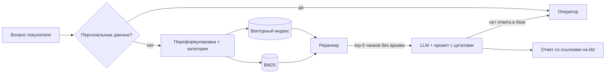

# 12.2 · README, схемы и демо для всех проектов  (AIL-50)

> **Неделя 12** · Портфолио · ⏱ ~4–6 ч · Проект

## Зачем это AI-инженеру

Портфолио смотрят 1–2 минуты. За это время README должен ответить на три вопроса: что это решает, как устроено и насколько хорошо работает. Для LLM-проектов третий вопрос решающий: «сделал чат-бота» умеют все, «поднял hit@5 с 0.71 до 0.89, и вот таблица экспериментов» — единицы. На собеседовании половину вопросов зададут по README, поэтому он же — готовый план рассказа о проекте.

В курсе четыре проекта и три репозитория, а значит, три README: `shop-analyst-bot` — бот-аналитик (проект 1), `support-kb-rag` — ассистент поддержки по базе знаний (проекты 2 и 3 живут в одной папке `projects/02-support-kb-rag/` и одном README «Shop Support Assistant: evals & experiments») и `order-investigator-agent` — агент-разборщик заказов (проект 4). Свои README у них появились ещё в главах 3.4, 5.5, 8.5 и 10.4, но писались в разное время и по-разному. Профиль из главы 12.1 теперь ведёт прямо в эти репозитории, поэтому в этой главе приводим все три README к одному шаблону.

## Теория

### README — это интерфейс, а не документация

Во многих экосистемах (npm, PyPI, Maven) привычен README библиотеки: установка, API, опции. README портфолио — другой жанр. Его читатель не будет запускать проект; он хочет за минуту оценить автора. Поэтому порядок перевёрнут: сначала результат, потом устройство, установка — в самом конце.

Единый шаблон для всех README:

```
┌─────────────────────────────────────────────┐
│ Название + одна строка: что делает            │  ← 5 сек
│ GIF/видео-демо (до ~15 сек)                   │  ← 15 сек
│ Ключевые цифры (таблица 2–4 строки)            │  ← 10 сек
├─────────────────────────────────────────────┤
│ Проблема: зачем это нужно (3–5 строк)          │
│ Решение: как работает (5–10 строк)             │  ← 1 мин
│ Архитектура: схема + пояснения                 │
├─────────────────────────────────────────────┤
│ Evals: методика, датасет, таблица экспериментов│
│ Что не сработало / ограничения                 │  ← для инженера
│ Стоимость и латентность                        │
├─────────────────────────────────────────────┤
│ Как запустить (uv / Docker, .env.example)      │
│ Структура репозитория                          │  ← для того, кто
│ Дальнейшие шаги                                │     дочитал
└─────────────────────────────────────────────┘
```

Это «перевёрнутая пирамида» из журналистики: самое важное — первым, каждое следующее разворачивает предыдущее. Тот, кто остановится после первого экрана, всё равно уйдёт с правильным впечатлением.

### Секция «Цифры»

Первый экран шаблона держится на цифрах: демо показывает, что проект работает, а цифры — насколько хорошо. Для каждого проекта выбираем 2–4 метрики, которые действительно измерены в главах про evals и production:

| Проект | Подходящие метрики |
|---|---|
| 1. Telegram-бот «аналитик магазина» | «N из 15» вопросов `questions.md` на демо-базе, средняя стоимость ответа, p50/p95 латентности |
| 2. Ассистент поддержки по `kb/` | hit@5 поиска на golden set, correctness/faithfulness ответов, доля ответов с верной ссылкой на раздел, правильные отказы |
| 3. Evals и эксперименты | таблица «конфигурация → метрика ± разброс», размер набора, строка holdout |
| 4. Агент-разборщик заказов | доля верных причин на 20 демо-случаях, pass^3, доля проверенных доказательств, шаги и стоимость на случай |

Обязательно указываем **базу сравнения и размер выборки**: «hit@5 0.89 на 80 вопросах (baseline 0.71)». Число без контекста ничего не говорит, а инженер, который читал про статистику evals, сразу спросит про n. Если различие между конфигурациями в пределах шума (см. главу [8.1 · Статистика evals: шум и размер выборки](AIL-62.md)) — так и пишем. Честное «разница не значима» вызывает больше доверия, чем красивые проценты.

### Схемы

Цифры отвечают на «насколько хорошо», схема — на «как устроено». Схема архитектуры — самый быстрый способ показать, что автор понимает систему. Два инструмента:

- **Mermaid** — диаграммы текстом прямо в Markdown; GitHub рендерит блок ```` ```mermaid ```` сам. Плюсы: живёт в репозитории, диффится, правится за минуту. Минусы: ограниченная раскладка.
- **Excalidraw** — рисованные схемы, экспорт в PNG/SVG. Плюсы: свобода и «человечный» вид. Минусы: картинку надо пересохранять при изменениях (можно экспортировать со встроенной сценой, чтобы потом открыть и поправить).

Пример для ассистента поддержки на Mermaid:



Правила хорошей схемы: 5–10 блоков, поток слева направо или сверху вниз, подписаны данные на стрелках там, где это важно (что передаётся), выделено то, что сделано своими руками (проверка персональных данных, реранкер, передача оператору, eval-цикл), а не стандартные коробки.

### Демо: GIF или видео

Вернёмся к верху шаблона: сразу под заголовком стоит демо. Оно показывает, что проект работает, раньше, чем читатель дойдёт до цифр. Варианты:

- **Терминальный GIF** — для CLI и скриптов evals. Удобные инструменты: VHS от Charm (пишем сценарий `.tape`, он рендерит GIF — воспроизводимо) или asciinema (запись реального терминала).
- **Запись экрана** — для Telegram-бота или Streamlit-интерфейса: встроенная запись экрана ОС (в macOS — Cmd+Shift+5, в других системах — штатное средство или OBS), потом обрезка и конвертация в GIF или MP4.
- **Видео** — GitHub показывает MP4, перетащенный в редактор README/issue, как встроенный плеер. GIF надёжнее отображается везде, но тяжелее; держим его до нескольких мегабайт и 10–20 секунд.

Сценарий демо: один вопрос → видно, как система работает (вызовы инструментов, источники) → ответ. Для бота — «какая выручка за неделю?», для ассистента — «можно ли вернуть вскрытый чай?» со ссылкой на `kb/returns.md#opened-tea-returns`, для агента — `python -m agent.run` с номером заказа из `data/demo_incidents.json`. Без набора текста по буквам в реальном времени — ускоряем или вставляем заготовленный ввод.

**Критично:** демо записывается только на демо-данных. Бот и агент показывают заказы из `data/demo_shop.db` (её создаёт `scripts/make_fake_db.py --seed 42`, у агента — с `--incidents 20`): та же схема, но ни снимка `data/shop.db`, ни имён и контактов покупателей, ни сумм и номеров заказов из снимка. Ассистент отвечает на выдуманные вопросы из golden set по выдуманной `kb/` — не на настоящие сообщения клиентов. Данные в снимке тоже выдуманы, но обращаемся с ними как с настоящими. На записи не должно быть терминала с переменными окружения, вкладок с почтой и админками, уведомлений и своего Telegram ID.

### Раздел «Что не сработало»

Ниже, в части для инженера, рядом с evals стоит раздел, которого обычно нет вовсе. Это самый недооценённый раздел. Он показывает инженерное мышление: эксперименты поставлены, провалы замечены, причины поняты. Пример: «Реранкер поверх большой модели не дал прироста correctness (разница в пределах шума на 80 вопросах), но добавил около секунды к p50 — для неё оставили поиск без реранкера; маленькой модели он помог». Две-четыре таких строки — и интервьюеру есть о чём спросить, а нам есть что рассказать.

### «Как запустить»

Последняя часть шаблона — для того, кто дочитал и захотел попробовать. Даже если никто не запустит, раздел должен быть рабочим — кто-то попробует, и сломанная установка запомнится. Минимум:

```bash
git clone https://github.com/<user>/support-kb-rag && cd support-kb-rag
cp .env.example .env        # put your DEEPSEEK_API_KEY here; .env is in .gitignore
uv sync                     # or set ANSWER_PROVIDER=ollama to run fully local, no key needed
uv run python ingest.py     # builds index.db from kb/
uv run python ask.py "можно ли вернуть вскрытый чай?"
```

`.env.example` содержит имена переменных без значений. Если проект упакован в Docker (глава [11.1 · Docker: упаковать проект](AIL-66.md)) — даём и вариант `docker compose up`. Указываем приблизительную стоимость прогона («полный eval ≈ $0.40 по ценам на <дата>»), иначе человек боится запускать.

### Профиль и закрепления

README профиля и закрепления мы сделали в главе [12.1 · Профиль GitHub и LinkedIn](AIL-67.md). Здесь проверяем согласованность: цифры в профиле совпадают с цифрами в README проектов, description каждого репозитория — та же «одна строка», что и в заголовке README.

### Признаки «сгенерированного» README

Последняя проверка — на тон. Ревьюеры уже научились узнавать README, написанный LLM без редактуры: эмодзи в каждом заголовке, «🚀 Features» со списком из 12 пунктов «seamless», «robust», «powerful», «leveraging cutting-edge», нет ни одной цифры, нет ограничений. LLM годится для черновика, но финальный текст — наш: конкретный, с цифрами и честными ограничениями.

## DeepSeek и Ollama: как это сделать у нас

В README это добавляет одну короткую секцию **«Models»** и меняет «Как запустить» и «Стоимость». Подаём проекты на DeepSeek и Ollama как сильную сторону: один клиент, провайдер меняется переменной окружения, качество сравнено на одном eval-наборе, а данные покупателей не покидают машину.

Если в проекте провайдер переключается через конфиг, стоит показать это в README парой строк — это лучшее доказательство «provider-agnostic»:

```python
# llm.py — one OpenAI-compatible client for every provider (illustrative)
import os
from openai import OpenAI

PROVIDERS = {
    "deepseek": ("https://api.deepseek.com", "DEEPSEEK_API_KEY"),
    "ollama":   ("http://localhost:11434/v1", None),  # local server, key is ignored
    "openai":   (None, "OPENAI_API_KEY"),             # default OpenAI endpoint
}

def make_client() -> OpenAI:
    # local by default: a fresh clone runs without keys and sends nothing to the cloud
    base_url, key_env = PROVIDERS[os.environ.get("LLM_PROVIDER", "ollama")]
    api_key = os.environ[key_env] if key_env else "ollama"
    return OpenAI(base_url=base_url, api_key=api_key)
```

В проектах 1 и 4 переменная называется `LLM_PROVIDER`, в ассистенте поддержки — `ANSWER_PROVIDER`; в README пишем ту, что в коде. Claude в такой схеме обычно идёт через свой SDK `anthropic` отдельным адаптером (у DeepSeek есть и Anthropic-совместимый endpoint `https://api.deepseek.com/anthropic` — на ноябрь 2026, актуальность стоит проверить).

Секция «Models» в README — таблица результатов на **одном и том же** eval-наборе:

```markdown
| Provider / model        | Correctness (n=80) | Cost per eval run | p50 latency | Data used          |
|-------------------------|--------------------|-------------------|-------------|--------------------|
| DeepSeek <model>        | 0.xx               | $0.0x             | x.x s       | kb/ + golden set   |
| Ollama <model:tag>      | 0.xx               | $0 (<device>, RAM)| x.x s       | kb/ + golden set   |
| Claude <model> (compare)| 0.xx               | $0.xx             | x.x s       | kb/ + golden set   |
```

Цифры — плейсхолдеры, ставим свои и дату прогона. Для бота и агента в колонке «Data used» — `demo DB`. Если Claude/OpenAI не вызывались — убираем строку, а не придумываем; но большинство вакансий упоминает именно их, так что один сравнительный прогон на демо-данных стоит сделать.

**Правило приватности — одной строкой в README каждого проекта.** Персональные данные покупателей и снимок базы магазина обрабатывает только локальная модель; облачные модели видят публичную `kb/`, golden set и демо-базу. Серверы DeepSeek в Китае, но правило касается любого облачного провайдера.

Что меняется по провайдерам:

| | Claude | OpenAI | DeepSeek | Ollama |
|---|---|---|---|---|
| Переменная в `.env.example` | `ANTHROPIC_API_KEY` | `OPENAI_API_KEY` | `DEEPSEEK_API_KEY` | ключ не нужен (локальный сервер) |
| SDK в проекте | `anthropic` | `openai` | `openai` + `base_url` | `openai` + `base_url` или библиотека `ollama` |
| Раздел «Стоимость» | $ за прогон по прайсу | то же | $ за прогон; на ноябрь 2026 у DeepSeek разные цены за cache hit/miss и скидка вне пиковых часов — указываем дату и условия | $0 за токены, но указываем железо (RAM), модель с тегом/квантизацией (`qwen3:4b`) и время прогона |
| Данные в демо и evals | демо-база, `kb/`, golden set | то же | то же, никогда снимок: серверы в Китае | снимок и сообщения покупателей — только здесь, локально; в репозиторий и демо — только демо-данные |
| Чего может не быть | — | — | эндпоинта эмбеддингов в документации на ноябрь 2026 не видно (стоит проверить), эмбеддинги берём локальные (`bge-m3`) | качество ниже крупных облачных моделей; `tool_choice` в OpenAI-совместимом API не поддерживается (на ноябрь 2026) |

Демо удобнее записывать на Ollama: без сети, без ключей в окружении, без счёта. Важно только убедиться, что выбрана локальная модель: у Ollama есть и облачные модели, запрос к которым уходит на ollama.com.

## Маршрут изучения

1. Открываем https://docs.github.com/en/get-started/writing-on-github/working-with-advanced-formatting/creating-diagrams → раздел про Mermaid (≈10 мин). Берём синтаксис блока и то, что GitHub рендерит его сам.
2. Открываем https://mermaid.js.org/ → Flowchart и Sequence diagram в разделе Syntax (≈25 мин). Обращаем внимание на `flowchart LR`, подписи стрелок `-->|text|` и формы узлов (`[(db)]` для хранилища). Sequence diagram пригодится для бота и агента: показать цикл «модель → инструмент → модель».
3. Открываем https://excalidraw.com → рисуем пробную схему из 5 блоков и экспортируем в PNG/SVG (≈15 мин). Проверяем опцию встраивания сцены при экспорте, чтобы файл можно было открыть и отредактировать позже.
4. Открываем https://github.com/charmbracelet/vhs → README, раздел с примером `.tape` (≈15 мин). Это сторонняя программа: перед установкой проверяем источник (официальный релиз или пакетный менеджер), версию и подпись, и только потом запускаем.
5. Открываем https://www.makeareadme.com (≈10 мин). Это шаблон для библиотек; сравниваем с шаблоном портфолио выше и отмечаем, какие секции сознательно переставлены.
6. Перечитываем свои README из глав [3.4 · Проект 1: логирование стоимости, README, GitHub](AIL-16.md), [5.5 · Проект 2: README и GitHub](AIL-25.md), [8.5 · Проект 3: таблица экспериментов в README](AIL-35.md), [10.4 · Проект 4: README и GitHub](AIL-43.md) (≈20 мин) и выписываем, чего в каждом не хватает относительно шаблона.
7. Открываем https://api-docs.deepseek.com/quick_start/pricing и https://docs.ollama.com/api/openai-compatibility (≈10 мин). Сверяем, что имена моделей и `base_url` в README и `.env.example` актуальны, и пересчитываем раздел «Стоимость» по текущим ценам DeepSeek (cache hit/miss, пиковые часы).

## На что обратить внимание

- **Битые картинки.** Относительные пути (`docs/arch.png`) работают в репозитории, но ломаются, если README копируют куда-то ещё. Медиа держим в `docs/` или `assets/` и проверяем отображение на github.com после push.
- **Тёмная тема.** PNG с прозрачным фоном и чёрными линиями исчезает в тёмной теме GitHub. Экспортируем с белым фоном или используем Mermaid (он адаптируется).
- **Тяжёлые GIF.** GIF на 30 МБ грузится долго и раздражает. Сокращаем длину, уменьшаем размер окна, снижаем частоту кадров.
- **Устаревшие цифры.** Сменили модель — перезапускаем evals и обновляем таблицу. Расхождение README и кода на собеседовании выглядит плохо.
- **Утечка в демо.** Уведомления, вкладки, переменные окружения, Telegram ID, ответы бота на снимке базы, настоящие сообщения клиентов. Перед записью — чистый рабочий стол и демо-база.
- **Ссылки на внешние API без ограничений.** Публичный демо-эндпоинт с нашим ключом выжгут за день. Живые эндпоинты с платными ключами без жёсткого лимита бюджета не публикуем; для портфолио достаточно GIF.

## Практика

- [ ] **Шаблон.** Создаём `notes/readme-template.md` с секциями из «Теории» (заголовки + по одной строке-подсказке в каждой).
- [ ] **Цифры.** Для каждого из 4 проектов выписываем в `notes/portfolio.md` 2–4 метрики с базой сравнения и n. Если какой-то метрики нет — прогоняем eval сейчас, а не придумываем.
- [ ] **Схемы.** По схеме на проект: бот (Mermaid sequence: владелец → Telegram → LLM → read-only функции → снимок SQLite, в README — демо-база), ассистент (flowchart как в «Теории»), evals (pipeline: `golden.jsonl` → `eval/run.py` → метрики и судья → таблица), агент (цикл агента + слой политики + MCP-сервер `mcp-shop`).
- [ ] **Демо-данные.** Проверяем, что бот и агент запускаются на `data/demo_shop.db` из `scripts/make_fake_db.py --seed 42` (для агента — `--incidents 20`), а не на копии снимка, и что генератор лежит в репозитории — это ещё и плюс к воспроизводимости. У ассистента демо-вопросы берём из golden set.
- [ ] **Секция «Models».** В каждом README — таблица провайдеров на одном eval-наборе: DeepSeek, модель в Ollama и, для сравнения, Claude или OpenAI (если ещё не вызывались — один прогон на демо-данных). В `.env.example` — переменная провайдера и `DEEPSEEK_API_KEY` без значения; проверяем, что с локальным провайдером (`LLM_PROVIDER=ollama` или `ANSWER_PROVIDER=ollama`) проект запускается без ключей. Строка о приватности на месте.
- [ ] **Демо.** Записываем по GIF/видео 10–20 секунд на каждый README. Кладём в `docs/demo.gif` (или вставляем MP4 через веб-редактор GitHub).
- [ ] **Переписать README.** Приводим все три README к шаблону: одна строка → демо → цифры → проблема → решение → архитектура → evals → что не сработало → стоимость → запуск. В README ассистента проект 2 и проект 3 — две части одной истории.
- [ ] **Проверка «как запустить».** Клонируем каждый репозиторий в чистую папку и проходим инструкцию буквально. Всё, что сломалось, исправляем.
- [ ] **Тест на 2 минуты.** Даём ссылку на профиль знакомому разработчику (или LLM с ролью «нанимающий инженер, у тебя 2 минуты») и просим рассказать, что делает каждый проект и насколько хорошо. Сравниваем с тем, что хотели донести.

## Готово, когда

- Все README следуют одному шаблону, начинаются с одной строки, демо и цифр.
- В каждом проекте есть схема, раздел evals с n и baseline, раздел «что не сработало», рабочий «как запустить».
- Демо записаны только на демо-базе и выдуманной `kb/`; снимка базы и сообщений клиентов в кадре нет.
- В каждом README одной строкой сказано, какие модели видели какие данные.
- Человек за 2 минуты понимает, что делает каждый проект и насколько хорошо.

## Тест для самопроверки

1. Почему в README портфолио установка стоит в конце, а не в начале, как у библиотек?
2. Что делает GitHub с блоком кода, помеченным `mermaid`?
   a) Показывает как код b) Рендерит диаграмму c) Требует GitHub Action d) Работает только в wiki
3. Что не так с этой строкой: «Our RAG achieves 94% accuracy»?
4. Какой раздел README лучше всего показывает инженерное мышление, но чаще всего отсутствует?
   a) Features b) License c) Что не сработало / ограничения d) Contributors
5. Почему PNG-схема может «исчезнуть» на GitHub?
6. Какие три вещи нельзя допустить в кадре демо-записи бота?
7. Зачем указывать примерную стоимость прогона evals в разделе запуска?
8. Что не так с этим разделом «Как запустить»?
   ```
   export OPENAI_API_KEY=sk-proj-abc123...
   python main.py
   ```
9. Эксперимент: конфигурация A — 0.81, B — 0.83 на 40 вопросах. Как это честно подать в README?
10. Какие три признака выдают README, сгенерированный LLM без редактуры?
11. Что должно быть в строке таблицы «Models» для Ollama вместо стоимости в долларах?
12. В README написано: «DeepSeek: faithfulness 0.84; Claude: 0.88». Первое мерили на 80 вопросах в октябре, второе — на 40 вопросах из другого набора. Что не так?
13. Почему демо проекта удобно записывать на Ollama и что при этом проверить?

## Ответы

1. Читатель портфолио не запускает проект, а оценивает автора за минуту; ему нужны результат и устройство. Установка нужна немногим и потому в конце.
2. **b.** GitHub рендерит Mermaid-диаграммы в Markdown нативно.
3. Нет базы сравнения, размера выборки, определения «accuracy» и датасета. Должно быть: метрика, n, baseline, как измерено.
4. **c.** Он показывает, что эксперименты ставились, провалы замечены и причины поняты.
5. Прозрачный фон с тёмными линиями сливается с тёмной темой GitHub. Решение — белый фон или Mermaid.
6. Данные из снимка базы (имена и контакты покупателей, номера заказов, суммы), переменные окружения и ключи в терминале, вкладки и уведомления с личной информацией (почта, мессенджеры, свой Telegram ID).
7. Человек не станет запускать то, цену чего не знает; это ещё и показывает, что автор считает стоимость.
8. В README лежит реальный (даже если частичный) ключ — его надо немедленно отозвать. Правильно: `.env.example` с пустой переменной, `.env` в `.gitignore`, загрузка через dotenv; плюс команда запуска через `uv run`.
9. Указать обе цифры с n и честно сказать, что на 40 вопросах разница в 2 п.п., скорее всего, в пределах шума; выбрать вариант по другому критерию (стоимость, простота) и написать об этом.
10. Эмодзи в каждом заголовке, общие слова («robust», «seamless», «cutting-edge»), длинный список Features без цифр, нет ограничений и экспериментов.
11. $0 за токены, но цена переезжает в железо и время: какое устройство и сколько RAM, какая модель с тегом/квантизацией, сколько длился прогон и латентность.
12. Сравнение некорректно: разные наборы и размеры выборки. Провайдеров сравнивают только на одном и том же eval-наборе, с n и датой прогона каждой строки.
13. Нет сети, ключей в окружении и счёта, данные не уходят с машины. Проверить, что выбрана локальная модель, а не облачная модель Ollama, и что в демо — демо-база, а не снимок.

## Что дальше

Лучший README отвечает «что и насколько хорошо», а статья — «почему и как мы к этому пришли»: [глава 12.3 · Статья на Хабр / LinkedIn](AIL-51.md).
