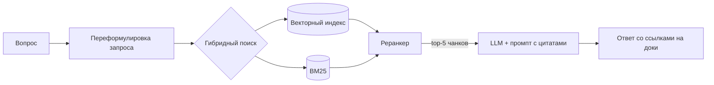

# 12.2 · README, схемы и демо для всех проектов  (AIL-50)

> **Неделя 12** · Портфолио · ⏱ ~4–6 ч · Проект

## Зачем это AI-инженеру

Портфолио смотрят 1–2 минуты. За это время README должен ответить на три вопроса: что это решает, как устроено и насколько хорошо работает. Для LLM-проектов третий вопрос решающий: «сделал чат-бота» умеют все, «поднял faithfulness с 0.71 до 0.89 и вот таблица экспериментов» — единицы. На собеседовании по README тебе зададут половину вопросов, поэтому он же — твой план рассказа о проекте.

## Теория

### README — это интерфейс, а не документация

В Node-мире ты привык к README библиотек: установка, API, опции. README портфолио — другой жанр. Его читатель не будет запускать проект; он хочет за минуту оценить автора. Поэтому порядок перевёрнут: сначала результат, потом устройство, установка — в самом конце.

Единый шаблон для всех четырёх проектов:

```
┌─────────────────────────────────────────────┐
│ Название + одна строка: что делает            │  ← 5 сек
│ GIF/видео-демо (до ~15 сек)                   │  ← 15 сек
│ Ключевые цифры (таблица 2–4 строки)            │  ← 10 сек
├─────────────────────────────────────────────┤
│ Проблема: зачем это нужно (3–5 строк)          │
│ Решение: как работает (5–10 строк)             │  ← 1 мин
│ Архитектура: схема + пояснения                 │
├─────────────────────────────────────────────┤
│ Evals: методика, датасет, таблица экспериментов│
│ Что не сработало / ограничения                 │  ← для инженера
│ Стоимость и латентность                        │
├─────────────────────────────────────────────┤
│ Как запустить (uv / Docker, .env.example)      │
│ Структура репозитория                          │  ← для того, кто
│ Дальнейшие шаги                                │     дочитал
└─────────────────────────────────────────────┘
```

Это «перевёрнутая пирамида» из журналистики: самое важное — первым, каждое следующее разворачивает предыдущее. Тот, кто остановится после первого экрана, всё равно уйдёт с правильным впечатлением.

### Секция «Цифры»

Для каждого проекта выбери 2–4 метрики, которые ты реально измерил в главах про evals и production:

| Проект | Подходящие метрики |
|---|---|
| Telegram-бот с tool calling | доля правильных вызовов функций на N тестовых вопросах, средняя стоимость ответа, p50/p95 латентность |
| RAG по докам бирж | recall@k ретривера, faithfulness/correctness ответов, доля ответов с корректной ссылкой |
| Эксперименты с evals | таблица «конфигурация → метрика ± разброс», размер датасета |
| Агент-разборщик сделок | доля успешных кейсов из 20, среднее число шагов, стоимость на кейс |

Обязательно указывай **базу сравнения и размер выборки**: «0.87 recall@5 на 80 вопросах (baseline 0.62)». Число без контекста ничего не говорит, а инженер, который читал про статистику evals, сразу спросит про n. Если различие между конфигурациями в пределах шума (см. главу [8.1 · Статистика evals: шум и размер выборки](AIL-62.md)) — так и пиши. Честное «разница не значима» вызывает больше доверия, чем красивые проценты.

### Схемы

Схема архитектуры — самый быстрый способ показать, что ты понимаешь систему. Два инструмента:

- **Mermaid** — диаграммы текстом прямо в Markdown; GitHub рендерит блок ```` ```mermaid ```` сам. Плюсы: живёт в репозитории, диффится, правится за минуту. Минусы: ограниченная раскладка.
- **Excalidraw** — рисованные схемы, экспорт в PNG/SVG. Плюсы: свобода и «человечный» вид. Минусы: картинку надо пересохранять при изменениях (можно экспортировать с встроенной сценой, чтобы потом открыть и поправить).

Пример для RAG-проекта на Mermaid:



Правила хорошей схемы: 5–10 блоков, поток слева направо или сверху вниз, подписаны данные на стрелках там, где это важно (что передаётся), выделено то, что сделал ты (реранкер, eval-цикл), а не стандартные коробки.

### Демо: GIF или видео

Демо в самом начале показывает, что проект работает. Варианты:

- **Терминальный GIF** — для CLI и скриптов evals. Удобные инструменты: VHS от Charm (пишешь сценарий `.tape`, он рендерит GIF — воспроизводимо) или asciinema (запись реального терминала).
- **Запись экрана** — для Telegram-бота или веб-UI: встроенная запись экрана macOS (Cmd+Shift+5), потом обрезка и конвертация в GIF или MP4.
- **Видео** — GitHub показывает MP4, перетащенный в редактор README/issue, как встроенный плеер. GIF надёжнее отображается везде, но тяжелее; держи его до нескольких мегабайт и 10–20 секунд.

Сценарий демо: один вопрос → видно, как система работает (вызовы инструментов, источники) → ответ. Без набора текста по буквам в реальном времени — ускорь или вставь заготовленный ввод.

**Критично:** демо записывается только на синтетических данных. Бот должен показывать вымышленные сделки из фейковой базы с той же схемой, без реальных PnL, бирж-аккаунтов и балансов. На скриншоте не должно быть терминала с переменными окружения, вкладок браузера с биржами и уведомлений.

### Раздел «Что не сработало»

Это самый недооценённый раздел. Он показывает инженерное мышление: ты ставил эксперименты, видел провалы и понимал причины. Пример: «Semantic chunking не дал прироста против фиксированных 512 токенов с перекрытием (разница в пределах шума на 80 вопросах), но стоил в 3 раза дороже при индексации — оставил фиксированный». Две-четыре таких строки — и интервьюеру есть о чём спросить, а тебе есть что рассказать.

### «Как запустить»

Даже если никто не запустит, раздел должен быть рабочим — кто-то попробует, и сломанная установка запомнится. Минимум:

```bash
git clone https://github.com/<you>/exchange-docs-rag && cd exchange-docs-rag
cp .env.example .env        # put your DEEPSEEK_API_KEY here; .env is in .gitignore
uv sync                     # or LLM_PROVIDER=ollama to run fully local, no key needed
uv run python -m rag.ingest data/sample_docs
uv run python -m rag.ask "What is the rate limit for order placement?"
```

`.env.example` содержит имена переменных без значений. Если проект упакован в Docker (глава [11.1 · Docker: упаковать проект](AIL-66.md)) — дай и вариант `docker compose up`. Укажи приблизительную стоимость прогона («полный eval ≈ $0.40 на текущих ценах»), иначе человек боится запускать.

### Профиль и закрепления

README профиля и закрепления ты сделал в главе [12.1 · Профиль GitHub и LinkedIn](AIL-67.md). Здесь проверь согласованность: цифры в профиле совпадают с цифрами в README проектов, description каждого репозитория — та же «одна строка», что и в заголовке README.

### Признаки «сгенерированного» README

Ревьюеры уже научились узнавать README, написанный LLM без редактуры: эмодзи в каждом заголовке, «🚀 Features» со списком из 12 пунктов «seamless», «robust», «powerful», «leveraging cutting-edge», нет ни одной цифры, нет ограничений. LLM можно использовать как черновик, но финальный текст — твой: конкретный, с цифрами и честными ограничениями.

## DeepSeek и Ollama: как это сделать у нас

В README это добавляет одну короткую секцию **«Models»** и меняет «Как запустить» и «Стоимость». Подавай проекты на DeepSeek и Ollama как сильную сторону: один клиент, провайдер меняется переменной окружения, качество сравнено на одном eval-наборе.

Если в проекте провайдер переключается через конфиг, покажи это в README парой строк — это лучшее доказательство «provider-agnostic»:

```python
# llm.py — one OpenAI-compatible client for every provider (illustrative)
import os
from openai import OpenAI

PROVIDERS = {
    "deepseek": ("https://api.deepseek.com", "DEEPSEEK_API_KEY"),
    "ollama":   ("http://localhost:11434/v1", None),  # local server, key is ignored
    "openai":   (None, "OPENAI_API_KEY"),             # default OpenAI endpoint
}

def make_client() -> OpenAI:
    base_url, key_env = PROVIDERS[os.environ.get("LLM_PROVIDER", "deepseek")]
    api_key = os.environ[key_env] if key_env else "ollama"
    return OpenAI(base_url=base_url, api_key=api_key)
```

Claude в такой схеме обычно идёт через свой SDK `anthropic` отдельным адаптером (у DeepSeek есть и Anthropic-совместимый endpoint `https://api.deepseek.com/anthropic` — на ноябрь 2026, проверь актуальное).

Секция «Models» в README — таблица результатов на **одном и том же** eval-наборе:

```markdown
| Provider / model        | Faithfulness (n=80) | Cost per eval run | p50 latency | Data used   |
|-------------------------|---------------------|-------------------|-------------|-------------|
| DeepSeek <model>        | 0.xx                | $0.0x             | x.x s       | synthetic   |
| Ollama <model:tag>      | 0.xx                | $0 (M-series Mac) | x.x s       | synthetic   |
| Claude <model> (compare)| 0.xx                | $0.xx             | x.x s       | synthetic   |
```

Цифры — плейсхолдеры, ставь свои и дату прогона. Если Claude/OpenAI не вызывал — убери строку, а не придумывай; но большинство вакансий упоминает именно их, так что один сравнительный прогон стоит сделать.

Что меняется по провайдерам:

| | Claude | OpenAI | DeepSeek | Ollama |
|---|---|---|---|---|
| Переменная в `.env.example` | `ANTHROPIC_API_KEY` | `OPENAI_API_KEY` | `DEEPSEEK_API_KEY` | ключ не нужен (локальный сервер) |
| SDK в проекте | `anthropic` | `openai` | `openai` + `base_url` | `openai` + `base_url` или библиотека `ollama` |
| Раздел «Стоимость» | $ за прогон по прайсу | то же | $ за прогон; на ноябрь 2026 у DeepSeek разные цены за cache hit/miss и скидка вне пиковых часов — укажи дату и условия | $0 за токены, но укажи железо, модель с тегом/квантизацией и время прогона |
| Данные в демо и evals | синтетика | синтетика | только синтетика: серверы в Китае | можно гонять реальные локально, но в репозиторий и демо — только синтетика |
| Чего может не быть | — | — | эндпоинта эмбеддингов в документации на ноябрь 2026 не видно (проверь), эмбеддинги берём локальные | качество ниже крупных облачных моделей; `tool_choice` в OpenAI-совместимом API не поддерживается (на ноябрь 2026) |

Демо удобнее записывать на Ollama: без сети, без ключей в окружении, без счёта. Только убедись, что выбрана локальная модель: у Ollama есть и облачные модели, запрос к которым уходит на ollama.com.

## Маршрут изучения

1. Открой https://docs.github.com/en/get-started/writing-on-github/working-with-advanced-formatting/creating-diagrams → раздел про Mermaid (≈10 мин). Возьми синтаксис блока и то, что GitHub рендерит его сам.
2. Открой https://mermaid.js.org/ → Flowchart и Sequence diagram в разделе Syntax (≈25 мин). Обрати внимание на `flowchart LR`, подписи стрелок `-->|text|` и формы узлов (`[(db)]` для хранилища). Sequence diagram пригодится для агента: показать цикл «модель → инструмент → модель».
3. Открой https://excalidraw.com → нарисуй пробную схему из 5 блоков и экспортируй в PNG/SVG (≈15 мин). Проверь опцию встраивания сцены при экспорте, чтобы файл можно было открыть и отредактировать позже.
4. Открой https://github.com/charmbracelet/vhs → README, раздел с примером `.tape` (≈15 мин). Это сторонняя программа: если решишь ставить — по твоему правилу проверь источник (официальный brew-tap/релиз, подпись), прежде чем запускать.
5. Открой https://www.makeareadme.com → (≈10 мин). Это шаблон для библиотек; сравни с шаблоном портфолио выше и отметь, какие секции ты сознательно переставил.
6. Перечитай свои README из глав [3.4 · Проект 1: логирование стоимости, README, GitHub](AIL-16.md), [5.5 · Проект 2: README и GitHub](AIL-25.md), [8.5 · Проект 3: таблица экспериментов в README](AIL-35.md), [10.4 · Проект 4: README и GitHub](AIL-43.md) (≈20 мин) и выпиши, чего в каждом не хватает относительно шаблона.
7. Открой https://api-docs.deepseek.com/quick_start/pricing и https://docs.ollama.com/api/openai-compatibility (≈10 мин). Сверь, что имена моделей и `base_url` в README и `.env.example` актуальны, и пересчитай раздел «Стоимость» по текущим ценам DeepSeek (cache hit/miss, пиковые часы).

## На что обратить внимание

- **Битые картинки.** Относительные пути (`docs/arch.png`) работают в репо, но ломаются, если README копируют куда-то ещё. Держи медиа в `docs/` или `assets/` и проверь отображение на github.com после пуша.
- **Тёмная тема.** PNG с прозрачным фоном и чёрными линиями исчезает в тёмной теме GitHub. Экспортируй с белым фоном или используй Mermaid (он адаптируется).
- **Тяжёлые GIF.** GIF на 30 МБ грузится долго и раздражает. Сократи длину, уменьши размер окна, снизь частоту кадров.
- **Устаревшие цифры.** Поменял модель — перезапусти evals и обнови таблицу. Расхождение README и кода на собеседовании выглядит плохо.
- **Утечка в демо.** Уведомления, вкладки, переменные окружения, реальные данные бота. Перед записью — чистый рабочий стол, синтетическая база.
- **Ссылки на внешние API без ограничений.** Если в README есть публичный демо-эндпоинт с твоим ключом — его выжгут за день. Не публикуй живые эндпоинты с платными ключами без жёсткого лимита бюджета; для портфолио достаточно GIF.

## Практика

- [ ] **Шаблон.** Создай `notes/readme-template.md` с секциями из «Теории» (заголовки + по одной строке-подсказке в каждой).
- [ ] **Цифры.** Для каждого из 4 проектов выпиши в `notes/portfolio.md` 2–4 метрики с базой сравнения и n. Если какой-то метрики нет — прогони eval сейчас, а не придумывай.
- [ ] **Схемы.** Нарисуй по схеме на проект: бот (Mermaid sequence: пользователь → Telegram → LLM → read-only функции → SQLite-копия), RAG (flowchart как в «Теории»), evals (pipeline: датасет → прогон → метрики → таблица), агент (цикл агента + инструменты + MCP).
- [ ] **Синтетические данные для демо.** Убедись, что у бота и агента есть фейковая база той же схемы (сгенерированная скриптом, не копия боевой). Положи генератор в репозиторий — это ещё и плюс к воспроизводимости.
- [ ] **Секция «Models».** В каждом README — таблица провайдеров на одном eval-наборе: DeepSeek, модель в Ollama и, для сравнения, Claude или OpenAI (если ещё не вызывал — один прогон на синтетике). В `.env.example` — `LLM_PROVIDER` и `DEEPSEEK_API_KEY` без значения; проверь, что с `LLM_PROVIDER=ollama` проект запускается без ключей.
- [ ] **Демо.** Запиши по GIF/видео 10–20 секунд на каждый проект. Положи в `docs/demo.gif` (или вставь MP4 через веб-редактор GitHub).
- [ ] **Переписать README.** Приведи все 4 README к шаблону: одна строка → демо → цифры → проблема → решение → архитектура → evals → что не сработало → стоимость → запуск.
- [ ] **Проверка «как запустить».** Склонируй каждый репозиторий в чистую папку и пройди инструкцию буквально. Всё, что сломалось, — исправь.
- [ ] **Тест на 2 минуты.** Дай ссылку на профиль знакомому разработчику (или LLM с ролью «нанимающий инженер, у тебя 2 минуты») и попроси рассказать, что делает каждый проект и насколько хорошо. Сравни с тем, что ты хотел донести.

## Готово, когда

- Все 4 README следуют одному шаблону, начинаются с одной строки, демо и цифр.
- В каждом проекте есть схема, раздел evals с n и baseline, раздел «что не сработало», рабочий «как запустить».
- Демо записаны только на синтетических данных.
- Человек за 2 минуты понимает, что делает каждый проект и насколько хорошо.

## Тест для самопроверки

1. Почему в README портфолио установка стоит в конце, а не в начале, как у библиотек?
2. Что делает GitHub с блоком кода, помеченным `mermaid`?
   a) Показывает как код b) Рендерит диаграмму c) Требует GitHub Action d) Работает только в wiki
3. Что не так с этой строкой: «Our RAG achieves 94% accuracy»?
4. Какой раздел README лучше всего показывает инженерное мышление, но чаще всего отсутствует?
   a) Features b) License c) Что не сработало / ограничения d) Contributors
5. Почему PNG-схема может «исчезнуть» на GitHub?
6. Назови три вещи, которые нельзя допустить в кадре демо-записи бота.
7. Зачем указывать примерную стоимость прогона evals в разделе запуска?
8. Что не так с этим разделом «Как запустить»?
   ```
   export OPENAI_API_KEY=sk-proj-abc123...
   python main.py
   ```
9. Эксперимент: конфигурация A — 0.81, B — 0.83 на 40 вопросах. Как это честно подать в README?
10. Какие признаки выдают README, сгенерированный LLM без редактуры? Назови три.
11. Что должно быть в строке таблицы «Models» для Ollama вместо стоимости в долларах?
12. В README написано: «DeepSeek: faithfulness 0.84; Claude: 0.88». Первое мерили на 80 вопросах в октябре, второе — на 40 вопросах из другого набора. Что не так?
13. Почему демо проекта удобно записывать на Ollama и что при этом проверить?

## Ответы

1. Читатель портфолио не запускает проект, а оценивает автора за минуту; ему нужны результат и устройство. Установка нужна немногим и потому в конце.
2. **b.** GitHub рендерит Mermaid-диаграммы в Markdown нативно.
3. Нет базы сравнения, размера выборки, определения «accuracy» и датасета. Должно быть: метрика, n, baseline, как измерено.
4. **c.** Он показывает, что ты ставил эксперименты, видел провалы и понимал причины.
5. Прозрачный фон с тёмными линиями сливается с тёмной темой GitHub. Решение — белый фон или Mermaid.
6. Реальные сделки/PnL/балансы, переменные окружения и ключи в терминале, вкладки и уведомления с личной информацией (биржи, мессенджеры).
7. Человек не станет запускать то, цену чего не знает; это ещё и показывает, что ты считаешь стоимость.
8. В README лежит реальный (даже если частичный) ключ — его надо немедленно отозвать. Правильно: `.env.example` с пустой переменной, `.env` в `.gitignore`, загрузка через dotenv; плюс команда запуска через `uv run`.
9. Указать обе цифры с n и честно сказать, что на 40 вопросах разница в 2 п.п., скорее всего, в пределах шума; выбрать вариант по другому критерию (стоимость, простота) и написать об этом.
10. Эмодзи в каждом заголовке, общие слова («robust», «seamless», «cutting-edge»), длинный список Features без цифр, нет ограничений и экспериментов.
11. $0 за токены, но цена переезжает в железо и время: на каком Mac (память), какая модель с тегом/квантизацией, сколько длился прогон и латентность.
12. Сравнение некорректно: разные наборы и размеры выборки. Провайдеров сравнивают только на одном и том же eval-наборе, с n и датой прогона каждой строки.
13. Нет сети, ключей в окружении и счёта, данные не уходят с машины. Проверить, что выбрана локальная модель, а не облачная модель Ollama, и что база в демо синтетическая.

## Что дальше

Лучший README отвечает «что и насколько хорошо», а статья — «почему и как ты к этому пришёл»: [глава 12.3 · Статья на Хабр / LinkedIn](AIL-51.md).
