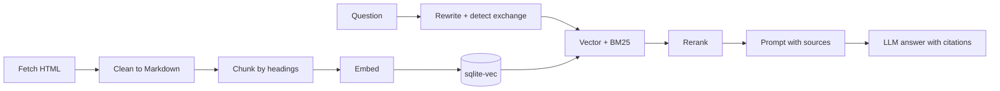

# 4.2 · Как устроен RAG: обзор архитектуры  (AIL-59)

> **Неделя 4** · RAG · ⏱ ~2–3 ч · Теория

## Зачем это AI-инженеру

RAG (Retrieval-Augmented Generation) — самый частый паттерн в продуктах на LLM: чат по документации, база знаний компании, поддержка, поиск по договорам. На собеседовании просят нарисовать RAG-систему на доске и объяснить, где она ломается. Если ты видишь всю цепочку целиком, каждую следующую задачу недели (chunking, индекс, гибридный поиск, цитаты) ты будешь класть на своё место, а не изучать изолированно.

## Теория

### Проблема, которую решает RAG

У LLM три ограничения: знания заморожены на дате обучения, модель не видит твоих приватных данных и уверенно выдумывает, когда не знает. Документация бирж меняется постоянно: новые эндпоинты, изменённые лимиты, deprecated-параметры. Спросить модель «какой rate limit у OKX на `/api/v5/trade/order`» без контекста — получить правдоподобную выдумку.

Идея RAG: **перед генерацией найти релевантные куски твоих документов и положить их в промпт**. Модель отвечает не «из головы», а по предоставленному тексту — как студент на открытом экзамене с конспектом.

Альтернативы и когда они лучше:

| Подход | Когда подходит |
|---|---|
| Положить всё в контекст (long context) | Документов мало (десятки страниц), они помещаются в окно модели; с prompt caching это бывает дешевле и проще RAG |
| Fine-tuning | Нужно изменить стиль/формат/поведение, а не добавить факты; факты через fine-tuning учатся плохо и устаревают |
| RAG | Документов много, они меняются, нужны ссылки на источник |

Доки четырёх бирж — тысячи страниц и они обновляются: классический случай для RAG. Статья Anthropic про Contextual Retrieval прямо говорит: если база меньше ~200 тысяч токенов, сначала попробуй просто положить её в промпт. Помни об этой планке — это хороший ответ на собеседовании.

### Две фазы: индексация и запрос

```
 ИНДЕКСАЦИЯ (офлайн, по расписанию / при обновлении доков)
 ┌─────────┐   ┌───────┐   ┌──────────┐   ┌───────────┐   ┌─────────────┐
 │загрузка │──►│ чистка│──►│ chunking │──►│эмбеддинги │──►│ индекс      │
 │HTML/PDF │   │→ MD   │   │+метаданные│  │ (+BM25)   │   │ (вектор БД) │
 └─────────┘   └───────┘   └──────────┘   └───────────┘   └─────────────┘

 ЗАПРОС (онлайн, на каждый вопрос)
 ┌──────┐  ┌─────────────┐  ┌─────────┐  ┌───────────┐  ┌────────┐  ┌───────┐
 │вопрос│─►│переформули- │─►│ поиск   │─►│ реранкинг │─►│ промпт │─►│ LLM → │
 │      │  │ровка+фильтры│  │ top-50  │  │  top-5    │  │+ куски │  │ответ+ │
 └──────┘  └─────────────┘  └─────────┘  └───────────┘  └────────┘  │ссылки │
                                                                    └───────┘
```

Это похоже на твоё приложение: есть фоновая работа (scheduler, загрузка рынков, кэш) и горячий путь (тик цены → решение). Индексация может быть медленной и дорогой, запрос должен быть быстрым.

### Каждый этап: что делает и что может сломаться

**1. Загрузка (ingestion).** Скачать HTML, PDF, Markdown, Confluence… Сломается: JS-рендеринг (страница пустая без браузера), навигация и футеры, попавшие в текст, устаревшие версии страниц.

**2. Чистка.** Превратить HTML в чистый Markdown: убрать меню, cookie-баннеры, сохранить заголовки, таблицы и блоки кода. Сломается: таблицы параметров превращаются в кашу, код теряет отступы. Для доков API таблицы и примеры запросов — самое ценное.

**3. Chunking.** Нарезать документы на куски, которые потом ищутся по отдельности. Слишком большой кусок — эмбеддинг «размыт», в промпт попадает лишнее; слишком маленький — теряется контекст («этот параметр» — какой?). Подробно — AIL-19.

**4. Метаданные.** У каждого чанка: биржа, URL, раздел (заголовки-предки), версия API, тип (REST/WebSocket). Они нужны для фильтров («только OKX») и для ссылок в ответе.

**5. Эмбеддинги.** Каждый чанк → вектор (AIL-18). Плюс обычно параллельно строят лексический индекс (BM25), чтобы точно находить имена эндпоинтов и параметров (AIL-22).

**6. Индекс.** Векторная БД или расширение к обычной (sqlite-vec, pgvector, Qdrant). Хранит векторы, текст, метаданные; умеет искать ближайших соседей с фильтром. AIL-20.

**7. Обработка запроса.** Пользователь пишет «а почему мне бинанс отказывает с -2019?». Это стоит переписать в поисковые запросы («Binance error code -2019 margin is insufficient»), выделить биржу и поставить фильтр. AIL-60.

**8. Поиск (retrieval).** Вектор + BM25 → объединение (RRF) → кандидаты, обычно 20–100.

**9. Реранкинг.** Более точная, но медленная модель (cross-encoder) пересортировывает кандидатов, оставляем 3–10. AIL-22.

**10. Сборка промпта.** Инструкция + пронумерованные куски с источниками + вопрос. Правила: отвечай только по кускам, ставь ссылки [1], [2], честно говори «не нашёл». AIL-23.

**11. Генерация и пост-обработка.** Ответ, ссылки на URL, проверка, что ссылки ссылаются на реально выданные куски.

### Где теряется качество

Ошибка RAG почти всегда в retrieval, а не в генерации. Если нужного куска нет в контексте, лучшая модель не ответит правильно (или выдумает). Поэтому метрики делятся на две группы:

- **Retrieval:** hit rate@k (попал ли нужный кусок в топ-k), recall@k, MRR (насколько высоко он стоит).
- **Generation:** faithfulness (ответ опирается на куски, а не выдуман), answer relevance (отвечает ли на вопрос), корректность ссылок.

Начинай с первой группы: она дешёвая (не нужен LLM), детерминированная и показывает, где болит. Весь путь недель 4–5 построен на одной идее — **маленький набор вопросов с известными ответами (golden set) и цифра hit rate после каждого улучшения**. Систематические evals будут дальше в плане, здесь — их минимальная форма.

### Contextual Retrieval: зачем читать вводную часть уже сейчас

Anthropic описывает проблему: чанк, вырванный из документа, теряет контекст. Кусок «Rate limit: 60 requests per 2 seconds» без указания эндпоинта и биржи почти бесполезен. Решение — перед эмбеддингом приписать к каждому чанку короткое пояснение, сгенерированное LLM по всему документу («Этот фрагмент из документации OKX API v5, раздел Place order, описывает лимит запросов»). Плюс BM25 рядом с эмбеддингами и реранкинг. Сейчас нужно понять **проблему**, решение будешь делать в AIL-22. Для доков API есть дешёвый вариант того же: приписывать к чанку хлебные крошки заголовков (`OKX > Trade > Place order > Rate limit`) — это ты сделаешь уже в AIL-19.

### Архитектурные решения, которые надо принять заранее

| Вопрос | Варианты | Решение для твоего проекта (по умолчанию) |
|---|---|---|
| Язык проекта | Python / TypeScript | Python: экосистема RAG, плюс цель — научиться его читать |
| Эмбеддинги | API / локально | Локально (Ollama или Sentence Transformers): у DeepSeek эмбеддингов нет; конкретная модель — по итогам сравнения в AIL-18 |
| Хранилище | sqlite-vec / pgvector / Qdrant | sqlite-vec: один файл, знакомый SQLite |
| Лексический поиск | BM25 в памяти / FTS5 в SQLite | Начни с `rank_bm25`, FTS5 — как улучшение |
| Генерация | Любая LLM с API | DeepSeek (`deepseek-flash`), офлайн-вариант — Ollama; Claude/OpenAI для сравнения; имя модели и `base_url` из `.env` |
| Реранкер | API / локальный cross-encoder | Локальный cross-encoder (Sentence Transformers) |
| Интерфейс | CLI / Streamlit / Telegram | CLI для отладки, потом Streamlit или бот |
| Обновление | Полная переиндексация / инкрементальная | Хэш содержимого чанка → не дублировать (AIL-20) |

### Чем RAG по докам бирж особенный

- **Точные идентификаторы:** `/api/v5/trade/order`, `reduceOnly`, `posSide`, код ошибки `-2019`. Чистые эмбеддинги их плохо различают → нужен гибридный поиск.
- **Похожие разделы у разных бирж:** «Place order» есть у всех четырёх → фильтр по бирже обязателен, иначе ответ про Bybit склеится с параметрами OKX.
- **Версии:** у бирж есть v1/v3/v5, spot/futures/unified. В метаданных храни продукт и версию.
- **Таблицы параметров и JSON-примеры** — ключевой контент; не резать их пополам.
- **Безопасность:** проект работает только с публичной документацией. Ему не нужны ключи бирж, он не делает подписанных запросов и не трогает базу твоего приложения.

## DeepSeek и Ollama: как это сделать у нас

Архитектура RAG от провайдера не зависит. Меняется только то, кто стоит в двух «модельных» квадратиках схемы: **эмбеддинги** и **генерация**. К генерации относятся ещё переписывание запроса и, по желанию, contextual-пояснения к чанкам.

```
 ИНДЕКСАЦИЯ: ... ─► chunking ─► [эмбеддинги: Ollama bge-m3 / Sentence Transformers] ─► sqlite-vec
 ЗАПРОС:     вопрос ─► [rewrite: DeepSeek или Ollama] ─► поиск ─► реранкер (локальный cross-encoder)
             ─► [ответ: DeepSeek; Ollama для приватного; Claude/OpenAI для сравнения] ─► ответ + ссылки
```

- **Эмбеддинги — локально.** У DeepSeek нет эндпоинта эмбеддингов (на ноябрь 2026; подробно в главе 4.1 · Эмбеддинги руками на numpy). Берём Ollama (`/api/embed`) или Sentence Transformers.
- **Генерация — DeepSeek.** На ноябрь 2026 по [странице Models & Pricing](https://api-docs.deepseek.com/quick_start/pricing) в API две модели: `deepseek-flash` (сейчас это DeepSeek-V4.1-Flash-1017) и `deepseek-v4-pro`. У обеих окно 1M токенов, JSON-вывод и tool calls, и у обеих по умолчанию **включён режим рассуждения** (thinking). Базовый URL для OpenAI SDK — `https://api.deepseek.com`. Имена моделей и цены меняются: держи имя модели в `.env` и проверяй страницу.
- **Реранкер — локально.** Эндпоинта реранкинга на ноябрь 2026 нет ни у DeepSeek, ни у Ollama (в их документации я его не нашёл). Cross-encoder запускается через Sentence Transformers (глава 5.2 · Гибридный поиск (BM25) и реранкинг).
- **Безопасность.** Проект работает с публичной документацией бирж, поэтому куски доков и свои вопросы о них отправлять в DeepSeek можно. Нельзя подмешивать в вопросы или в индекс что-то из торгового приложения (сделки, логи, ключи, балансы): серверы DeepSeek в Китае. Если позже захочешь RAG по своим данным, вся цепочка (эмбеддинги + генерация) — только на Ollama.

### Что это меняет в решении «RAG или всё в контекст»

Планка «меньше ~200K токенов — попробуй положить всё в промпт» из статьи Anthropic зависит от окна и цены. У DeepSeek окно 1M, а **кэширование контекста включено автоматически для всех** ([гайд Context Caching](https://api-docs.deepseek.com/guides/kv_cache)): повторяющийся префикс запроса берётся с диска и стоит в десятки раз дешевле. На 13.11.2026 у `deepseek-flash` в непиковое время вход при попадании в кэш стоит $0.003 за 1M токенов, при промахе $0.15, выход $0.60. В пиковые часы (01:00–04:00 и 06:00–10:00 UTC в будни) цены вдвое выше. Кэш best-effort: попадание не гарантировано, а неиспользуемый кэш очищается через часы или дни.

Для доков четырёх бирж (тысячи страниц, миллионы токенов) RAG всё равно нужен: всё не влезет даже в 1M, а ссылки на конкретный раздел нужны в любом случае. Зато для одного большого раздела (например, только «Error codes» одной биржи) вариант «весь раздел в промпт» на DeepSeek стал дешёвым. Держи его в голове как baseline.

### Сравнение провайдеров для RAG

| Что нужно RAG | Claude | OpenAI | DeepSeek | Ollama |
|---|---|---|---|---|
| Эмбеддинги | Своих нет (рекомендован Voyage AI) | Есть | **Нет** → Ollama / Sentence Transformers | Есть, локально |
| Эндпоинт реранкинга | Нет (у партнёров вроде Voyage, Cohere) | Нет | Нет → локальный cross-encoder | Нет → Sentence Transformers |
| Генерация ответа | Да | Да | Да, `deepseek-flash` / `deepseek-v4-pro` | Да; качество зависит от размера модели и памяти Mac |
| Окно контекста | Смотри документацию модели | Смотри документацию модели | 1M токенов | Ограничено моделью и памятью; задаётся `num_ctx` |
| Кэш длинного префикса | Явный, через `cache_control` | Автоматический (смотри гайд OpenAI) | Автоматический; поля `prompt_cache_hit_tokens` / `prompt_cache_miss_tokens` в `usage` | Платы нет — платишь временем своего Mac |
| Встроенные цитаты (Citations) | Да | В Chat Completions нет (что есть в других API OpenAI — смотри документацию) | Нет; Anthropic-совместимый эндпоинт DeepSeek поле `citations` **игнорирует** | Нет |
| Куда уходят данные | США | США | **Китай** | Никуда |

Вывод для проекта: цитаты делаем вручную (`[n]` + проверка кодом, глава 5.3), эмбеддинги и реранкер — локально, генерация — DeepSeek. Ollama — полностью офлайн-вариант и путь для всего приватного.

Ограничение железа: у тебя M2 с 8 GB, и на нём же работает арбитражное приложение. Эмбеддинг-модели маленькие (`bge-m3` ~1.2 GB), а локальный генератор — только класса 4B (`qwen3:4b`, ~2.5 GB). 7–8B — лишь при закрытых остальных приложениях и не включённой автоторговле, 14B+ — нет. Эмбеддинги, реранкер и генератор, загруженные одновременно, складываются по памяти. Это ещё одна причина, почему генерация здесь на DeepSeek: доки публичные, и отправлять их можно.

### Что использовать в практике

Практика этой главы — схема и решения, провайдеры здесь только подписи на квадратиках. Подпиши их честно: «эмбеддинги: Ollama `bge-m3` (локально)», «генерация: DeepSeek `deepseek-flash`, имя модели из `.env`», «реранкер: Sentence Transformers (локально)», «Claude/OpenAI — опционально, для сравнения». На будущее запомни правило для evals: судья (LLM-as-judge) должен быть сильнее модели, которую он оценивает. Например, ответы `deepseek-flash` или локальной модели проверяет `deepseek-v4-pro` или Claude.

## Маршрут изучения

1. Открой [Eugene Yan: Patterns for Building LLM-based Systems](https://eugeneyan.com/writing/llm-patterns/) → прочитай введение и раздел «Retrieval-Augmented Generation» (≈45 мин). Обрати внимание на: почему retrieval важнее генерации, гибридный поиск (BM25 + эмбеддинги), ANN-индексы, пример с тем, как классический поиск помогает там, где эмбеддинги промахиваются. Раздел про evals бегло — он пригодится позже.
2. Открой [Anthropic: Contextual Retrieval](https://www.anthropic.com/news/contextual-retrieval) → прочитай вводную часть до раздела с реализацией контекстных эмбеддингов, плюс заметку про базы меньше 200K токенов (≈20 мин). Вынеси формулировку проблемы «чанк теряет контекст» и цифры улучшения retrieval в статье — к ним вернёшься в AIL-22.
3. Открой [DeepLearning.AI short courses](https://www.deeplearning.ai/short-courses/) → найди в каталоге курс по RAG (там их несколько, набор меняется; ищи по слову «RAG» или «Retrieval») и посмотри первые 2–3 урока на 1.5x (≈45 мин). Цель — увидеть, как кто-то другой рисует ту же цепочку; не делай все ноутбуки.
4. Сравни три источника с диаграммой из «Теории» этой главы: какие этапы у кого есть, у кого нет (≈15 мин). Запиши расхождения — это вопросы, которые прояснятся в следующих главах.
5. Открой [DeepSeek: Models & Pricing](https://api-docs.deepseek.com/quick_start/pricing) и [Context Caching](https://api-docs.deepseek.com/guides/kv_cache) (≈20 мин). Вынеси текущие имена моделей, окно контекста, цены входа с попаданием и с промахом кэша, пиковые часы, как работает автоматический кэш и какие поля `usage` его показывают.
6. Открой [DeepSeek: Anthropic API](https://api-docs.deepseek.com/guides/anthropic_api) → таблицу совместимости (≈10 мин). Найди, что происходит с `cache_control` и `citations` (на ноябрь 2026 оба игнорируются). Это пример того, что «совместимый API» ≠ «те же возможности».
7. Если ещё не читал в главе 4.1, открой [Ollama: Embeddings](https://docs.ollama.com/capabilities/embeddings) (≈10 мин), чтобы подписать квадратик «эмбеддинги» на своей схеме.

## На что обратить внимание

- **«Подключим RAG — и галлюцинаций не будет».** Нет: если retrieval нашёл не то, модель уверенно ответит по неправильному куску. RAG снижает, а не устраняет выдумки; цитаты и отказ «не нашёл» — обязательная часть.
- **Улучшать генерацию, когда сломан поиск.** Типичная ошибка — неделю тюнить промпт, хотя нужного куска просто нет в топ-5. Сначала hit rate.
- **Нет golden set.** Без 20 вопросов с известными ответами любое «стало лучше» — ощущение. Собирай его с первого дня.
- **Устаревший индекс.** Доки обновились, индекс — нет. Храни дату загрузки и хэш страницы.
- **Смешение бирж** в одном ответе: без фильтров по метаданным легко получить «гибрид» из параметров разных API.
- **Слишком много контекста.** 30 чанков в промпте — дорого, медленно и модель теряет важное в середине. Лучше 5 хороших после реранкинга.
- **Фреймворк как чёрный ящик.** LlamaIndex/LangChain собирают RAG в 10 строк, но отлаживать их сложнее. Поэтому сначала руками, а фреймворк — в AIL-24 для сравнения.

## Практика

- [ ] Создай `exchange-docs-rag/notes/rag.md`.
- [ ] Нарисуй схему своего RAG по докам бирж (ASCII в Markdown, или Mermaid — GitHub его рендерит; или картинка из Excalidraw, сохранённая рядом). Обе фазы: индексация и запрос. Для каждого этапа подпиши:
  - вход и выход (например, «HTML страницы → Markdown + URL»);
  - конкретный инструмент, который планируешь использовать (можно с вопросом: «sqlite-vec?»);
  - номер задачи плана, где он будет сделан (AIL-19, AIL-20, AIL-60, AIL-22, AIL-23).
- [ ] Ниже схемы — таблица метаданных чанка: поле, тип, пример, зачем нужно. Минимум: `exchange`, `url`, `section_path`, `chunk_id`, `content_hash`, `fetched_at`.
- [ ] Раздел «Риски»: 5 вещей, которые могут пойти не так именно с доками бирж, и что ты с ними сделаешь.
- [ ] Раздел «Golden set (черновик)»: первые 10 вопросов, на которые ты хочешь, чтобы система отвечала, с ожидаемой биржей и страницей. Примеры: «Какой лимит запросов на размещение ордера у Bybit V5?», «Как в OKX указать сторону позиции в hedge mode?», «Что означает код ошибки -2019 у Binance Futures?», «Как часто Gate начисляет funding?». Плюс 3 вопроса, на которые ответа в доках нет («Какая биржа самая надёжная?») — для проверки отказа в AIL-23.
- [ ] Раздел «Решения»: заполненная таблица архитектурных решений из теории с твоими выборами. В строках «Эмбеддинги», «Генерация», «Реранкер» укажи провайдера и причину (основной путь: Ollama/Sentence Transformers + DeepSeek; Claude/OpenAI — для сравнения).
- [ ] Раздел «Данные и провайдеры»: таблица «какой текст куда уходит» (куски доков → DeepSeek; вопросы → DeepSeek; эмбеддинги → только локально) и правило «ничего из торгового приложения в этот проект».

Пример фрагмента в Mermaid:



## Готово, когда

- В `notes/rag.md` есть схема обеих фаз, где у каждого этапа подписаны вход/выход, инструмент (с провайдером) и задача плана.
- Есть таблица метаданных, список рисков, черновик golden set из 10+3 вопросов и таблица решений.
- Ты можешь за 3 минуты устно провести кого-то по схеме и сказать, где чаще всего ломается RAG.

## Тест для самопроверки

1. Какие три ограничения LLM решает (или смягчает) RAG?
2. Документация на 60 страниц (~80K токенов), меняется раз в год. Что попробовать первым? a) RAG с векторной БД b) fine-tuning c) положить всё в контекст, возможно с prompt caching d) обучить свою модель эмбеддингов
3. Назови этапы фазы индексации по порядку.
4. Почему в RAG по докам API нужна фильтрация по метаданным?
5. Где чаще всего ломается RAG — в retrieval или в генерации? Как это проверить дёшево?
6. Что такое hit rate@k?
7. Какую проблему описывает статья Anthropic про Contextual Retrieval?
8. Что не так в этом промпте?
   ```
   Вот документы: {chunks}
   Ответь на вопрос пользователя максимально полно, используя свои знания: {question}
   ```
9. Чем реранкинг отличается от первичного поиска? a) это то же самое b) реранкер точнее, но медленнее, и применяется к небольшому числу кандидатов c) реранкер работает до эмбеддингов d) реранкер нужен только для BM25
10. Зачем хранить у чанка `content_hash` и `fetched_at`?
11. Почему fine-tuning — плохой способ «научить» модель актуальным лимитам API бирж?
12. Какие этапы RAG в стеке «DeepSeek + Ollama» выполняются локально и почему? a) только генерация b) эмбеддинги и реранкинг, потому что у DeepSeek нет для них эндпоинтов c) всё идёт в DeepSeek d) только BM25
13. Ты переводишь код с Claude на Anthropic-совместимый эндпоинт DeepSeek и рассчитываешь на встроенные Citations и `cache_control`. Что произойдёт?
14. Почему куски документации бирж можно отправлять в DeepSeek, а выгрузку своих сделок для «RAG по моей истории» нельзя?

## Ответы

1. Знания заморожены на дате обучения; модель не видит приватных/специфичных данных; модель выдумывает, когда не знает. RAG даёт актуальный контекст и позволяет ссылаться на источник.
2. c). Документы маленькие и стабильные — проще и надёжнее положить их целиком в промпт; RAG — лишняя сложность, fine-tuning плохо учит факты.
3. Загрузка → чистка → chunking (с метаданными) → эмбеддинги (и лексический индекс) → запись в индекс.
4. Одинаковые разделы («Place order», «Rate limits») есть у всех бирж; без фильтра в контекст попадут куски чужой биржи, и ответ смешает их параметры.
5. В retrieval. Дёшево проверить hit rate@k на golden set: попал ли нужный кусок в топ-k — без вызова LLM.
6. Доля вопросов, для которых хотя бы один правильный кусок оказался в первых k результатах поиска.
7. Чанк, вырезанный из документа, теряет контекст (о какой бирже, эндпоинте, разделе речь), поэтому плохо находится и плохо понимается; предлагают приписывать к чанку сгенерированное пояснение и сочетать эмбеддинги с BM25 и реранкингом.
8. «Используя свои знания» прямо разрешает отвечать не по документам — это открывает дорогу галлюцинациям. Нет требования ссылок, нет инструкции говорить «не нашёл», куски не пронумерованы и без источников.
9. b). Первичный поиск быстрый и грубый по всей базе, реранкер (cross-encoder) медленнее, но точнее, и пересортировывает 20–100 кандидатов.
10. Хэш — чтобы при повторной загрузке не создавать дубликаты и переэмбеддить только изменившееся; дата — чтобы понимать актуальность и показывать её пользователю.
11. Fine-tuning плохо запоминает конкретные факты, не даёт ссылок на источник и устаревает при каждом изменении доков — переобучать дорого, а RAG-индекс обновляется загрузкой.
12. b). На ноябрь 2026 у DeepSeek нет ни эмбеддингов, ни реранкера. Эмбеддинги делает Ollama или Sentence Transformers, реранкинг — локальный cross-encoder, а DeepSeek отвечает за генерацию и переписывание запроса.
13. По таблице совместимости DeepSeek оба поля игнорируются. Цитат с гарантией не будет, а кэш у DeepSeek работает сам, автоматически по префиксу. Цитаты придётся делать вручную: `[n]` + проверка кодом.
14. Документация бирж публична, утекать там нечему. Сделки, логи и ключи — приватные данные, а серверы DeepSeek в Китае. Такой RAG строится целиком на Ollama, локально.

## Что дальше

Теперь режем реальные доки: [AIL-19 · Chunking: сравнить 3 стратегии](AIL-19.md), затем строим полноценный индекс в [AIL-20 · Векторная БД + загрузка доков бирж](AIL-20.md).
