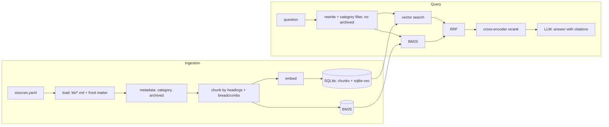

# 5.5 · Project 2: a README of the RAG assistant for GitHub  (AIL-25)

> **Week 5** · RAG · ⏱ ~4 h · Project

<!-- description: A portfolio README for a RAG project: structure, results table, architecture diagram, running from scratch, limitations and public repo hygiene. -->
<!-- source-sha256: d8a7900e02a4 -->

## Why an AI engineer needs this

This is the second project in the portfolio. A hiring manager spends 2–5 minutes on a repository: reads the README, looks at the diagram and the numbers, sometimes tries to run it. A project without a README and without quality numbers looks like a study notebook; a project with a "vector / hybrid / hybrid + reranker" table, an honest section on limitations and a three-command launch looks like an engineer's work. In an interview this README is a ready-made outline for talking about the project.

⚠️ The public repository of project 2 contains the code and the fictional knowledge base `kb/`, and nothing else from the shop. The `index.db` index, the `raw/` cache, `.env`, real customer messages and the shop database snapshots from project 1 must not get into it as a file, a screenshot or a line of the README — not now, and not in the git history.

## Theory

### Who reads a README and what they look for

| Reader | Time | What they look for |
|---|---|---|
| Recruiter / HR | 30 seconds | What it is, the stack, whether there is a demo (screenshot/GIF) |
| Hiring engineer | 3–5 minutes | Architecture, decisions and their rationale, quality numbers, code style, tests |
| We, in an interview | — | A ready story: problem → decisions → measurements → conclusions |
| We, six months later | 10 minutes | How to run it |

Hence the order: first **what and why** (with a picture), then **how it works and how well**, then **how to run it**, details at the end.

### README structure

```
# Shop Support KB RAG
One sentence: what it is. A screenshot or GIF.

## Problem                 — why: a 30–50 page shop knowledge base, customers asking in their own words, a link to the exact section is needed
## Demo                    — 3–4 question → answer examples with links (+ one refusal)
## Architecture            — a diagram (Mermaid), two phases: ingestion and query
## How retrieval works     — chunking, hybrid, filters, reranker: a paragraph each, with the "why"
## Results                 — golden set, metric tables, what each improvement gave
## Manual vs LlamaIndex    — from AIL-24
## Quickstart              — from git clone to the first answer
## Project structure       — a tree with one line per file
## Evaluation              — how to rerun the eval
## Limitations & next steps— honestly
## License / Disclaimer
```

A sample line for Demo: "can I return opened tea?" → a short answer and the source `kb/returns.md#opened-tea-returns`; a refusal for a question the knowledge base doesn't cover.

The README can be written in English (the widest audience) or in another language; what matters is that it is consistent. In a non-English README, file names, commands and metrics stay as they are anyway.

### The Results section is the heart of the README

Numbers are what set an engineering project apart from a demo. We show:

- **How the golden set is built**: 20 questions, which types (conversational wording, no explicit category, exact identifiers like the `MUG-NORTH` SKU, comparisons of Light vs Light Mini, questions spanning two sections), how the "correct chunk" is defined.
- **The retrieval table** (from AIL-19, AIL-60, AIL-22): the path of improvements, not just the final number. In AIL-19 the strategies were compared on 10 questions and by hit@3 only, so we rerun the early rows on the same 20 questions with the same `eval/run_retrieval_eval.py`; otherwise the rows are not comparable:

  | Configuration | hit@3 | hit@5 | MRR | p50, ms |
  |---|---|---|---|---|
  | baseline: vector, fixed chunks | | | | |
  | + chunking by headings | | | | |
  | + rewrite + category filter | | | | |
  | + BM25 (RRF) | | | | |
  | + reranker | | | | |

- **The answers table** (AIL-23): correct / with citations / appropriate refusals.
- **An honest caveat**: 20 questions is a small sample; a difference of 1–2 questions is noise.

We don't tweak the numbers and don't remove "inconvenient" rows: "the reranker didn't help on questions with SKUs, because…" is stronger than a perfect table. That is exactly what they will ask about.

### Architecture diagram

The numbers need context: the reader should see which stages a question goes through. GitHub renders Mermaid right in Markdown: the diagram is stored as text, it is easy to change and it shows up in diffs:

````markdown

````

Archived pages get into the index marked `archived` and are cut off by a filter at search time (`include_archived=False`), which is why the filter sits in the query phase on the diagram, not in ingestion: the diagram must match the code. We start from the diagram in our own `notes/rag.md` (AIL-59) and update it to reflect reality — something has surely changed.

### Reproducibility: "runs from scratch"

The diagram and the numbers convince only when the project can be checked by oneself. The task's acceptance criterion is that **the project runs from the README in a clean environment**. What that takes:

1. **Pinned dependencies.** A `requirements.txt` with exact versions (`pip freeze` after checking) or `pyproject.toml` + a lock file if we work with `uv`/poetry. A stated Python version.
2. **`.env.example`**: a list of variables without values:
   ```
   ANTHROPIC_API_KEY=
   OPENAI_API_KEY=        # only if you use OpenAI embeddings
   EMBED_MODEL=
   REWRITE_MODEL=
   ANSWER_MODEL=
   RERANK_MODEL=
   ```
   The user copies it to `.env` and fills it in. The real `.env` is in `.gitignore`.
3. **The knowledge base is in the repository, the index is not.** We commit `kb/`: these are sources, the texts are made up and belong to us. The `index.db` index and the `raw/` cache **are not committed**: they are rebuilt by a script and bloat the repository, and a public page downloaded into `raw/web/` (the optional item of AIL-20) belongs to its owner. The repository holds the code that builds the index (`ingest.py`) and `sources.yaml`.
4. **One entry point per action**: `make ingest`, `make ask Q="..."`, `make eval`, `make app`, `make test`, or equivalent short commands in the README. A Makefile is essentially the same as `scripts` in `package.json` or Gradle tasks: action name → command.
5. **Expected time and cost**: "indexing `kb/` (30–50 pages): ~N minutes, ~$X for embeddings with an API model (or free with a local one)".
6. **Offline tests** run without keys or network: `pytest` passes on a clean clone.
7. **The "from scratch" check**: we clone the repository into a new folder, create a new venv and follow the README strictly. Every hitch is a fix to the README.

### Public repository hygiene

Everything needed to run the project must get into the repository, and everything extra must stay outside. The project lives in `projects/02-support-kb-rag/` of the study repository; whether we publish it whole or move the project into a separate one, the checks below apply to everything that ends up on GitHub, including the history.

- **Secrets.** Before the first push we check not only the current files but **the whole commit history**: a key committed once and deleted later stays in the history. A tool for this is, for example, [gitleaks](https://github.com/gitleaks/gitleaks) (`gitleaks detect` over the repository). If a key has leaked, we **revoke it with the provider** immediately; rewriting history doesn't help (someone may already have seen it).
- **`.gitignore`**: `.env`, `.venv/`, `index*.db*` (`index.db`, `index_ctx.db`), `raw/`, `cache/`, `__pycache__/`, `.DS_Store`, LlamaIndex persist folders.
- **No personal data and nothing from the shop databases.** The project works only with the knowledge base; it doesn't and mustn't contain `shop.db` snapshots from project 1, paths to `../shop-live/`, real customer messages, logs with their questions or the Telegram bot token from project 1. The questions in the golden set and Demo are made up.
- **Disclaimer**: a study project; the Shelf shop and its rules are fictional; the model's answers may be inaccurate and are worth checking against the section links.
- **A license** for the code (MIT is a common choice for a portfolio) and for the `kb/` texts: they are ours and can be released under the same or a separate license. We don't distribute someone else's web page from `raw/web/`.
- **A clean commit history**: meaningful messages. 50 commits named "fix" are not needed.

### What earns extra points (optional)

- **A screenshot or GIF** of the interface from AIL-23 at the top of the README.
- **CI**: GitHub Actions running `pytest` (offline tests) on every push; a green badge shows the tests are real.
- **A "Design decisions" section**: why sqlite-vec, why chunking by headings, why the archive is excluded by a filter, why the refusal is a fixed phrase — 1–2 sentences per decision.
- **Sample eval output** in `eval/RESULTS.md`, linked from the README.

### The Limitations section

Honest limitations show maturity. Examples for this project: the knowledge base is fictional and small (30–50 pages); the index is updated manually by running `ingest.py`; the golden set of 20 questions is written by the author (risk of overfitting); answers are evaluated by hand; contradictions inside the knowledge base (the free delivery threshold in `delivery.md` and `promo.md`) are not resolved; handoff to a human is a record in `outputs/handoff.jsonl`, not a support queue. And next steps: automatic eval with an LLM judge, reindexing when `kb/` changes, an interface for customers with handoff to a human operator, contextual retrieval over the whole index.

## DeepSeek and Ollama: how we do it

For the README, the provider matters in four places.

1. **`.env.example` for our stack.** Instead of the variables from "Theory":
   ```
   ANSWER_PROVIDER=deepseek      # deepseek | ollama | anthropic (comparison)
   DEEPSEEK_API_KEY=
   ANSWER_MODEL=                 # e.g. deepseek-flash; check api-docs.deepseek.com
   REWRITE_MODEL=
   OLLAMA_BASE_URL=http://localhost:11434/v1
   ANSWER_MODEL_LOCAL=           # e.g. qwen3:4b, for the offline mode (8 GB RAM)
   EMBED_BACKEND=ollama          # ollama | st
   EMBED_MODEL=                  # e.g. bge-m3
   RERANK_MODEL=                 # local cross-encoder, e.g. BAAI/bge-reranker-v2-m3
   ANTHROPIC_API_KEY=            # optional, comparison runs only
   ```
2. **Quickstart with Ollama.** We add the steps "install Ollama following the official instructions for your OS at ollama.com, `ollama pull bge-m3` (and a local LLM for the offline mode)" and honest requirements: how much disk space and memory the models take (for example, "the offline mode was tested on a machine with 8 GB RAM with a 4B-class model; 7–8B models need 16 GB") and that `ingest` doesn't work without a running Ollama. The "fully offline" mode (Ollama for embeddings and answers) is a strong point for the README: the project can be run without a single key.
3. **Cost and time.** "Indexing: free, local embeddings, ~N minutes (CPU, amount of RAM). Answer: ~$X per question on `deepseek-flash`, calculated from `usage` (date, prices from [api-docs.deepseek.com](https://api-docs.deepseek.com/quick_start/pricing)); at peak hours DeepSeek is twice as expensive." The date is mandatory: prices and model names change.
4. **Where the data goes.** One paragraph in the README: with `ANSWER_PROVIDER=deepseek`, questions and the retrieved knowledge base chunks are sent to the DeepSeek API (servers in China); embeddings and reranking are local. The knowledge base is public, so the cloud is acceptable for it. Real customer messages never go to the cloud: there is the Ollama mode for them. The README's reader (and the interviewer) should see this.

In the Results section we state **which models** produced the numbers (the embedding backend and model, the reranker, the generator, the date) and, if we did them, the DeepSeek / Ollama / Claude comparison rows from chapters 5.1 and 5.3. A "same pipeline, different generators" table is a good interview topic.

| What matters for the README | Claude | OpenAI | DeepSeek | Ollama |
|---|---|---|---|---|
| Key needed | Yes | Yes | Yes (`DEEPSEEK_API_KEY`) | No |
| What to state in Quickstart | Key | Key | Key, model name | Installation, `ollama pull`, disk space |
| Cost | Per token | Per token | Per token, cache hits cheaper, peak hours more expensive | Free; the machine's time and memory |
| Data note | US cloud | US cloud | Cloud in China — state it explicitly | Local |

## Learning path

1. [GitHub Docs: About READMEs](https://docs.github.com/en/repositories/managing-your-repositorys-settings-and-features/customizing-your-repository/about-readmes) (≈10 min). Takeaways: where GitHub looks for the README, how relative links and heading anchors work (we check that the links to `kb/` sections from Demo open).
2. [GitHub Docs: Creating diagrams](https://docs.github.com/en/get-started/writing-on-github/working-with-advanced-formatting/creating-diagrams) → the Mermaid section (≈15 min). We sketch the diagram and check it in the GitHub preview or in the Mermaid Live Editor.
3. The READMEs of two or three well-known RAG/LLM repositories on GitHub (for example, [rank_bm25](https://github.com/dorianbrown/rank_bm25), [sqlite-vec](https://github.com/asg017/sqlite-vec)): how their quickstart and examples are built (≈20 min). We take structure ideas, not texts.
4. [gitleaks](https://github.com/gitleaks/gitleaks) → README: installation and `detect` over a local repository (≈15 min). It is a third-party tool: before installing it we check the source (the official brew formula, a GitHub release with a checksum check, or our OS's package).
5. (Optional) The GitHub Actions documentation: the Python quickstart — a workflow that installs dependencies and runs `pytest` (≈20 min).
6. We check the model names and prices in the README against [DeepSeek: Models & Pricing](https://api-docs.deepseek.com/quick_start/pricing), and Ollama's system requirements against the official page for our OS (for example, [Ollama: macOS](https://docs.ollama.com/macos)) (≈10 min). We write the date of the check next to the numbers.

## What to watch out for

- **The README doesn't match the code**: commands renamed, environment variables added, and the README is out of date. The only protection is the "from scratch" run at the end.
- **A key in the git history** is the most expensive mistake; we check the history, not just the last commit.
- **A committed index / `raw/`** bloats the repository and distributes someone else's content. `kb/`, on the contrary, must be in git: without it the index can't be built.
- **An archived page in Demo.** If an answer example cites `kb/returns-2025.md`, that is not decoration but a retrieval bug — we fix the filter first.
- **Tests that need network or keys** fail for anyone who clones the repository. We separate the offline tests from the eval that calls the API.
- **Numbers without a methodology** ("95% accuracy") breed distrust. Always: on which set, how many questions, how it was calculated.
- **Absolute paths** (`/Users/...`, `C:\...`) in the code or the README: other people don't have them. Only relative paths and environment variables.
- **Hardcoded model names** in the code: we move them to `.env`; models change.
- **Publishing is a deliberate decision.** Before the push we go through the checklist below; the repository can first be created private and made public once everything is checked.

## Practice

- [ ] **Cleanup.** We remove dead code and experimental notebooks that aren't needed (or move them to `experiments/` with a note). Model names and paths come from `.env`/config.
- [ ] **Dependencies.** `requirements.txt` (or `pyproject.toml` + lock) with exact versions; a separate `requirements-llamaindex.txt` if the LlamaIndex version lives in the same repository. The README states the Python version.
- [ ] **`.env.example`** with all the variables (the DeepSeek + Ollama variant from the section above); `.gitignore` following the list from the theory.
- [ ] **Ollama in Quickstart**: installation steps, `ollama pull` of the required models, disk space and RAM, the "no keys" mode (everything on Ollama). A "Where the data goes" paragraph.
- [ ] **Entry points.** A `Makefile` (or a commands section in the README): `setup`, `ingest`, `ask`, `app`, `eval`, `test`.
- [ ] **README** following the structure from the theory:
  - [ ] one sentence + a screenshot/GIF;
  - [ ] Problem;
  - [ ] Demo: 3–4 questions from the golden set with answers and `kb/<file>.md#<anchor>` links + 1 refusal;
  - [ ] Architecture: a Mermaid diagram of the two phases;
  - [ ] How retrieval works: chunking, the category filter and archive exclusion, hybrid + RRF, the reranker — a paragraph each, with the "why";
  - [ ] Results: the golden set methodology, the table of the retrieval improvement path, the answers table, the sample size caveat;
  - [ ] Manual vs LlamaIndex (from AIL-24);
  - [ ] Quickstart; Project structure; Evaluation; Limitations & next steps; License; Disclaimer.
- [ ] **Checking for secrets and data.** `git log -p | grep -iE "api_key|sk-|token"` as a quick look and a full gitleaks check over the whole history. We make sure that `.env`, `index.db`, `raw/` and any `*.db` are not tracked (`git ls-files`) and never appeared in the history (`git log --all --stat -- '*.db' '.env' 'raw/*'`), while `kb/` is tracked.
- [ ] **Run from scratch.** `git clone` into a new folder → a new venv → strictly following the README: `setup` → fill in `.env` → `ingest` → `ask` → `app` → `test`. We write down every hitch and fix the README. We repeat until it passes without a single question.
- [ ] **(Optional) CI.** `.github/workflows/test.yml`: offline `pytest` on push; a badge in the README.
- [ ] **Push to GitHub.** We create the repository (it can be private at first), push, open the page on GitHub and check: the Mermaid diagram renders, links and images work, tables are readable. Then we make it public and turn on secret scanning / push protection.
- [ ] **Pitch.** At the end of the README or in our notes: 5 sentences about the project for an interview — the problem, the architecture, the most useful improvement (with a number), the main lesson, what we would do next.

## Done when

- The project runs from the README from scratch in a clean clone and a new environment: from `git clone` to an answer with links to `kb/` sections without a single undocumented command.
- The README has an architecture diagram, a description of retrieval, sample questions and answers, quality numbers with a methodology, a comparison with LlamaIndex and limitations.
- `kb/`, `sources.yaml`, the indexing script and the run instructions are in place; `index.db`, `raw/` and `.env` are not in the repository.
- The repository and its history contain no secrets, personal data, real customer messages or anything from the shop databases; the project is pushed to GitHub.

## Self-check quiz

1. Name the order of the main README sections and explain why "how to run it" doesn't come first.
2. Why is it not worth committing the index (`index.db`) and the web page downloaded into `raw/`, while `kb/` is worth committing? Two reasons for the former.
3. A `.env` with a key was committed, then deleted in the next commit and pushed. Is that enough? a) yes, the file is gone b) no: the key is in the history; the key must be revoked with the provider c) making the repository private is enough d) `git rm --cached .env` is enough
4. Why `.env.example` if there is `.env`?
5. What is wrong with this README fragment?
   ```
   ## Results
   Accuracy: 95%. The system works great.
   ## Quickstart
   cd /Users/me/projects/rag && python ingest.py
   ```
6. Why is it worth showing the path of improvements in Results, not just the final number?
7. Why is a Mermaid diagram in a README better than a PNG image?
8. How do we check that a project "runs from scratch"?
9. Why must offline tests not require keys or network?
10. What should go into Limitations for this project? Three items.
11. Why can't real customer messages and data from the shop database snapshot be used in Demo, the golden set and examples?
12. Why is it worth stating separately in the README of a DeepSeek-based project where the data goes, and what should that say?
13. How can the project be made runnable with no cloud keys at all? a) it can't b) a mode where embeddings, the reranker and generation are local (Ollama + Sentence Transformers), selected by environment variables c) commit our own DeepSeek key d) use any cloud's free tier

## Answers

1. What and why (with a picture) → demo → architecture → how retrieval works → results → comparison → quickstart → structure → eval → limitations → license. Value and evidence come first: most readers won't run the project but will decide based on the first screens.
2. The index and `raw/` are rebuilt by a script and bloat the repository; the downloaded web page belongs to its owner, and distributing it is not our right. `kb/` is the source: without it the index can't be built, and the texts are made up and belong to the author.
3. **b.** The key stays in the git history and may already have been copied; the only reliable measure is to revoke and reissue the key (and optionally clean up the history as well).
4. It shows which variables are needed, without values; the real `.env` with secrets isn't committed, and the user has something to copy and fill in.
5. A number without a methodology (on what, how many questions, which metric) and a value judgment "works great"; the absolute path `/Users/me/...` won't work for others; the venv, installing dependencies, `.env` and starting Ollama aren't shown.
6. It shows the engineering process and the contribution of each decision (chunking, category filter, BM25, reranker): that is an interview topic and proof that the author measured rather than guessed.
7. It is stored as text next to the code, easy to edit, visible in diffs and rendered by GitHub without separate files.
8. Clone into a new folder, create a new environment and follow the README strictly without deviations; every hitch is a fix to the README; repeat until a clean pass.
9. Otherwise they fail for anyone who clones the repository and in CI; offline tests check the logic (tokenization, RRF, the archive filter, citations), and API calls belong to a separate eval.
10. For example: a small fictional knowledge base; a small golden set written by the author; manual evaluation of answers; the index is updated manually; contradictions inside the knowledge base are not resolved; handoff to a human without a real support queue.
11. The repository is public: customers' names, phone numbers and order numbers and the shop's figures are private data, and tokens and database paths are a security risk. This project works only with the knowledge base; questions for the demo and the golden set are made up. The shop data in the course is fictional too, but we treat it as real.
12. The user's questions and knowledge base chunks go to a cloud API with servers in China; the user should know this before asking anything. The paragraph covers: what is sent (the question + the retrieved chunks), what stays local (embeddings, the reranker), why this is acceptable (the knowledge base is public) and which mode to choose for real customer messages (Ollama).
13. **b.** Providers are switched by environment variables, and in the offline mode all models run on Ollama and Sentence Transformers. Committing a key is not allowed, and free cloud tiers may train on the input data.

## What's next

Project 2 is done. The next stage of the plan builds on it: in weeks 6–8 the same assistant in `projects/02-support-kb-rag/` becomes project 3 — the golden set and metric tables we have collected become the basis for systematic evals and an LLM judge, and the knowledge base search itself becomes a tool for the agent in later chapters. We start with how LLM systems are evaluated: [AIL-27 · LLM evals: the key articles and LLM-as-judge](AIL-27.md).
