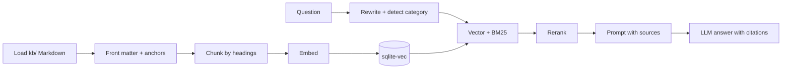

# 4.2 · How RAG works: an architecture overview  (AIL-59)

> **Week 4** · RAG · ⏱ ~2–3 h · Theory

<!-- description: RAG architecture: indexing and query phases, what each stage does and where quality is lost, Contextual Retrieval, RAG vs long context. -->
<!-- source-sha256: 3be0196ec532 -->

## Why an AI engineer needs this

RAG (Retrieval-Augmented Generation) is the most common pattern in LLM products: chat over documentation, a company knowledge base, support, search over contracts. In interviews we get asked to draw a RAG system on a whiteboard and explain where it breaks. In chapter 4.1 we learned one link of the chain: searching texts by meaning with embeddings. Here we see the whole chain, and we put each of the week's next tasks (chunking, the index, hybrid search, citations) in its place instead of studying it in isolation.

## Theory

### The problem RAG solves

An LLM has three limitations: its knowledge is frozen at the training date, it doesn't see our private data, and it confidently makes things up when it doesn't know. A shop's knowledge base changes all the time: new shipping rates, different return windows, new products with their own warranty. Asking a model "can I return opened tea to the Shelf shop" without context gets a plausible fabrication.

The idea of RAG: **before generating, find the relevant pieces of our documents and put them into the prompt**. The search by meaning from the previous chapter helps find them. The model answers not "off the top of its head" but from the text it is given, like a student at an open-book exam.

Alternatives and when they are better:

| Approach | When it fits |
|---|---|
| Put everything into the context (long context) | There are few documents (tens of pages) and they fit into the model's window; with prompt caching this is sometimes cheaper and simpler than RAG |
| Fine-tuning | The goal is to change style/format/behavior, not to add facts; facts are learned poorly through fine-tuning and go stale |
| RAG | There are many documents, they change, and links to the source are needed |

Anthropic's article on Contextual Retrieval says it directly: if the knowledge base is smaller than ~200 thousand tokens, it is worth simply putting it into the prompt first. This threshold is useful to remember: it is a good interview answer. Our study knowledge base (30–50 pages, which we put together in chapters 4.3–4.4) most likely falls under it, and we honestly keep the "everything in the prompt" option as a baseline. We build RAG for links to the exact section and for a skill that is needed on knowledge bases of thousands of pages, where "everything in the prompt" no longer works.

### Two phases: indexing and query

```
 INDEXING (offline, on a schedule / when the docs are updated)
 ┌─────────┐   ┌───────┐   ┌───────────┐   ┌───────────┐   ┌─────────────┐
 │ loading │──►│ clean │──►│ chunking  │──►│embeddings │──►│ index       │
 │HTML/PDF │   │→ MD   │   │+metadata  │   │ (+BM25)   │   │ (vector DB) │
 └─────────┘   └───────┘   └───────────┘   └───────────┘   └─────────────┘

 QUERY (online, for every question)
 ┌──────────┐  ┌─────────────┐  ┌─────────┐  ┌───────────┐  ┌──────────┐  ┌──────────┐
 │ question │─►│ rewrite     │─►│ search  │─►│ reranking │─►│ prompt   │─►│ LLM →    │
 │          │  │ + filters   │  │ top-50  │  │  top-5    │  │ + chunks │  │ answer + │
 └──────────┘  └─────────────┘  └─────────┘  └───────────┘  └──────────┘  │ citations│
                                                                          └──────────┘
```

This resembles an ordinary backend: there is background work (cron, queues, cache warm-up) and a hot path (user request → response). Indexing can be slow and expensive; a query has to be fast.

### Each stage: what it does and what can break

Let's go through the stages using our project as the example. Its corpus is the `kb/` folder: the Shelf shop's help center as Markdown files (`delivery.md`, `returns.md`, `warranty.md`, product pages in `products/`…). Each file starts with front matter, a block of metadata between `---` lines (`title`, `category`, `updated`, and `archived: true` on the old edition of the rules). We write the pages in chapter 4.3.

**1. Loading (ingestion).** Download or read HTML, PDF, Markdown, Confluence… What breaks: JS rendering (the page is empty without a browser), navigation and footers that end up in the text, outdated versions of pages. In our project the main source is the Markdown files of `kb/` on disk, so half of these problems go away; web pages are optional.

**2. Cleaning.** Turn HTML into clean Markdown: remove menus and cookie banners, keep headings, tables and code blocks. What breaks: tables turn into mush, code loses its indentation. For the shop's knowledge base, the tables of shipping rates and warranty periods are the most valuable part.

**3. Chunking.** Cut documents into pieces that are later searched separately. A chunk that is too big gives a "blurred" embedding and brings extra text into the prompt; one that is too small loses context ("this product": which one?). Details in AIL-19.

**4. Metadata.** Each chunk has: a category (`category`: shipping, returns, warranty…), the file path with the section anchor, the section (ancestor headings), the update date, and an archived-page flag (`archived`). They are needed for filters ("only returns", "no archived pages") and for links in the answer.

**5. Embeddings.** Each chunk → a vector (AIL-18). Usually a lexical index (BM25) is also built alongside, to find SKUs, product names and promo codes exactly (AIL-22).

**6. Index.** A vector database or an extension to an ordinary one (sqlite-vec, pgvector, Qdrant). It stores vectors, text and metadata, and can search for nearest neighbors with a filter. AIL-20.

**7. Query processing.** A customer writes "so can I send back tea I've already opened?". This is worth rewriting into search queries ("returning opened tea", "which products can't be returned"), detecting the category and setting a filter: `category = returns`, archived pages excluded. AIL-60.

**8. Search (retrieval).** Vector search and BM25 give two result lists, which are merged (RRF, Reciprocal Rank Fusion: merging by positions in the result lists, AIL-22) → candidates, usually 20–100.

**9. Reranking.** A more accurate but slower model (a cross-encoder: it reads the question and the chunk together and outputs a relevance score instead of comparing precomputed vectors) re-sorts the candidates, and we keep 3–10. AIL-22.

**10. Prompt assembly.** Instruction + numbered chunks with sources + the question. Rules: answer only from the chunks, put citations [1], [2], honestly say "not found" (in our project, also hand the question over to a human). AIL-23.

**11. Generation and post-processing.** The answer, links to sections (`kb/returns.md#opened-tea-returns`), a check that the citations point to chunks that were actually provided.

### Where quality is lost

A RAG error is almost always in retrieval, not in generation. If the needed chunk isn't in the context, the best model won't answer correctly (or will make something up). That is why the metrics fall into two groups:

- **Retrieval:** hit rate@k (whether the needed chunk made it into the top-k), recall@k (what share of all needed chunks made it into the top-k), MRR (how high the first needed chunk ranks).
- **Generation:** faithfulness (the answer relies on the chunks rather than being made up), answer relevance (whether it answers the question), correctness of citations.

We start with the first group: it is cheap (no LLM needed), deterministic and shows where it hurts. The whole path of weeks 4–5 is built on one idea: **a small set of questions with known answers (golden set) and a hit rate number after every improvement**. Systematic evals come later in the plan; here is their minimal form.

### Contextual Retrieval: why read the introduction now

One of the common causes of retrieval misses sits back in indexing, in how a chunk is torn away from its document. Anthropic describes this problem: a chunk pulled out of a document loses context. The chunk "The warranty is 12 months from the date of purchase" without the product name is almost useless: is it the Light Lamp or the Light Mini? The solution is to prepend to each chunk, before embedding, a short explanation generated by an LLM from the whole document ("This fragment is from the 'Light Lamp' product page, 'Warranty' section, and describes the warranty period"). Plus BM25 alongside the embeddings, and reranking. For now we need to understand the **problem**; the solution comes in AIL-22. For documents with headings there is a cheap version of the same thing: prepend the heading breadcrumbs to the chunk (`Products > Light Lamp > Warranty`), which we do as early as AIL-19.

### Architecture decisions to make up front

The stages are clear; each one needs a specific tool. Some decisions are easier to make once now than to change in the middle of the project.

| Question | Options | Decision for our project (default) |
|---|---|---|
| Project language | Python / another language (JS, Go…) | Python: the richest RAG ecosystem, and the whole course uses it |
| Embeddings | API / local | Local (Ollama or Sentence Transformers): DeepSeek has no embeddings; the specific model follows the comparison in AIL-18 |
| Storage | sqlite-vec / pgvector / Qdrant | sqlite-vec: one file, familiar SQLite |
| Lexical search | In-memory BM25 / FTS5 in SQLite | Start with `rank_bm25`, FTS5 as an improvement |
| Generation | Any LLM with an API | DeepSeek (`deepseek-flash`), Ollama as the offline option; Claude/OpenAI for comparison; model name and `base_url` from `.env` |
| Reranker | API / local cross-encoder | Local cross-encoder (Sentence Transformers) |
| Interface | CLI / Streamlit / Telegram | CLI for debugging, then Streamlit or a bot |
| Updates | Full reindexing / incremental | Hash of the chunk content → no duplicates (AIL-20) |

### What makes RAG over a shop's knowledge base special

The general scheme fits any RAG, but our corpus has its own traps, and the checks in the next chapters are built around exactly them.

- **Exact identifiers:** SKUs, promo codes, names like Light and Light Mini, payment decline codes. Pure embeddings tell them apart poorly → hybrid search is needed.
- **Similar sections on different pages:** a "Warranty" section is on every product page, and the return rules are in `returns.md` and in the archived `returns-2025.md` → filters on `category` and `archived` are mandatory; otherwise an answer about one lamp gets glued to the warranty of another, and the current rules to the old ones.
- **Versions:** the old edition of the return rules sits next to the new one. In the metadata we store `archived` and the update date; by default the archive is excluded from search.
- **Tables of rates and warranties** are key content; don't cut them in half. Separately: numbers that differ between pages (the free shipping threshold in `delivery.md` and in `promo.md`), and questions whose answer is assembled from two sections.
- **Security:** the project works only with the public knowledge base. It doesn't need customer data, doesn't open the shop's databases and changes nothing in orders.

## DeepSeek and Ollama: how we do it

The RAG architecture doesn't depend on the provider. The only thing that changes is who sits in the two "model" boxes of the diagram: **embeddings** and **generation**. Generation also covers query rewriting and, optionally, contextual explanations for chunks.

```
 INDEXING: ... ─► chunking ─► [embeddings: Ollama bge-m3 / Sentence Transformers] ─► sqlite-vec
 QUERY:    question ─► [rewrite: DeepSeek or Ollama] ─► search ─► reranker (local cross-encoder)
           ─► [answer: DeepSeek; Ollama for private data; Claude/OpenAI for comparison] ─► answer + citations
```

- **Embeddings: local.** As of November 2026, DeepSeek has no embeddings endpoint; details in chapter 4.1 · Embeddings by hand with numpy (AIL-18). We use Ollama (`/api/embed`) or Sentence Transformers.
- **Generation: DeepSeek.** As of November 2026, according to the [Models & Pricing page](https://api-docs.deepseek.com/quick_start/pricing), the API has two models: `deepseek-flash` (currently DeepSeek-V4.1-Flash-1017) and `deepseek-v4-pro`. Both have a 1M-token window, JSON output and tool calls, and both have **reasoning mode (thinking) on by default**. The base URL for the OpenAI SDK is `https://api.deepseek.com`. Model names and prices change: we keep the model name in `.env` and check the page.
- **Reranker: local.** As of November 2026, neither DeepSeek nor Ollama has a reranking endpoint (it can't be found in their documentation). A cross-encoder runs via Sentence Transformers; details in AIL-22.
- **Security.** The shop's knowledge base is public (it is its help center), so chunks of the knowledge base and questions about it may be sent to cloud models, DeepSeek included. Nothing from the shop's application may be mixed into the questions or the index: orders, customer data, the event log, payment provider keys. Real customer messages (names, phone numbers, order numbers) don't go to the cloud: for tests on customer messages we use made-up texts or a local model. DeepSeek's servers are in China, but the rule applies to any cloud provider. If RAG over private data is needed later, the whole chain (embeddings + generation) runs only on Ollama.

### What this changes in the "RAG or everything in the context" decision

The threshold from the Anthropic article, "under ~200K tokens, try putting everything into the prompt", depends on the window and the price. DeepSeek has a 1M window, and **context caching is on automatically for everyone** ([Context Caching guide](https://api-docs.deepseek.com/guides/kv_cache)): a repeated request prefix is served from disk and costs tens of times less. As of November 13, 2026, off-peak input for `deepseek-flash` costs $0.003 per 1M tokens on a cache hit and $0.15 on a miss, with output at $0.60. During peak hours (01:00–04:00 and 06:00–10:00 UTC on weekdays) prices are twice as high. The cache is best-effort: a hit isn't guaranteed, and an unused cache is cleared after hours or days.

The whole `kb/` of the Shelf shop will almost certainly fit into 1M, so the "entire knowledge base in the prompt" option on DeepSeek is a cheap and honest baseline: we keep it in mind and compare against it. RAG is still needed: the answer has to link to a specific section, archived rules must not be shown to the model on a par with the current ones, and a real company's knowledge base quickly grows to thousands of pages and millions of tokens that won't fit even into 1M. Our small knowledge base is a test range where every retrieval error is visible.

### Comparing providers for RAG

| What RAG needs | Claude | OpenAI | DeepSeek | Ollama |
|---|---|---|---|---|
| Embeddings | None of its own (Voyage AI recommended) | Yes | **No** → Ollama / Sentence Transformers | Yes, local |
| Reranking endpoint | No (partners like Voyage, Cohere have one) | No | No → local cross-encoder | No → Sentence Transformers |
| Answer generation | Yes | Yes | Yes, `deepseek-flash` / `deepseek-v4-pro` | Yes; quality depends on model size and the computer's memory |
| Context window | See the model's documentation | See the model's documentation | 1M tokens | Limited by the model and memory; set with `num_ctx` |
| Long prefix cache | Explicit, via `cache_control` | Automatic (see the OpenAI guide) | Automatic; `prompt_cache_hit_tokens` / `prompt_cache_miss_tokens` fields in `usage` | No charge: we pay with our own computer's time |
| Built-in citations (Citations) | Yes | Not in Chat Completions (for what other OpenAI APIs offer, see the documentation) | No; DeepSeek's Anthropic-compatible endpoint **ignores** the `citations` field | No |
| Where the data goes | USA | USA | **China** | Nowhere |

Conclusion for the project: we do citations by hand (`[n]` + a code check, chapter 5.3), embeddings and the reranker run locally, generation is DeepSeek. Ollama is the fully offline option and the path for everything private.

Hardware limits. Embedding models are small (`bge-m3` ~1.2 GB), while the size of a local generator is bounded by memory: with 8 GB RAM, models of the 3–4B class (`qwen3:4b`, ~2.5 GB); with 16 GB, 7–8B; with 32 GB or more, 14B and larger. Embeddings, reranker and generator loaded at the same time add up in memory, plus everything else running on the machine. This is one more reason why generation here is on DeepSeek: the knowledge base is public, and it may be sent.

### What to use in the practice

The practice in this chapter is a diagram and decisions; providers here are just labels on the boxes. We label them honestly: "embeddings: Ollama `bge-m3` (local)", "generation: DeepSeek `deepseek-flash`, model name from `.env`", "reranker: Sentence Transformers (local)", "Claude/OpenAI: optional, for comparison". For the future, let's remember the rule for evals: a judge (LLM-as-judge) must be stronger than the model it evaluates. For example, answers from `deepseek-flash` or a local model are checked by `deepseek-v4-pro` or Claude.

## Learning path

1. We open [Eugene Yan: Patterns for Building LLM-based Systems](https://eugeneyan.com/writing/llm-patterns/) → read the introduction and the "Retrieval-Augmented Generation" section (≈45 min). Points to note: why retrieval matters more than generation, hybrid search (BM25 + embeddings), ANN indexes, the example of how classic search helps where embeddings miss. The evals section can be skimmed; it will be useful later.
2. We open [Anthropic: Contextual Retrieval](https://www.anthropic.com/news/contextual-retrieval) → read the introduction up to the section on implementing contextual embeddings, plus the note about knowledge bases under 200K tokens (≈20 min). We write down the "a chunk loses context" problem statement and the article's retrieval improvement numbers; we come back to them in AIL-22.
3. We open [DeepLearning.AI short courses](https://www.deeplearning.ai/short-courses/) → find a RAG course in the catalog (there are several, and the set changes; search for "RAG" or "Retrieval") and watch the first 2–3 lessons at 1.5x (≈45 min). The goal is to see how someone else draws the same chain; there is no need to go through all the notebooks.
4. We compare the three sources with the diagram from this chapter's "Theory": which stages each one has and which it lacks (≈15 min). We write down the discrepancies: these are questions that get cleared up in the next chapters.
5. We open [DeepSeek: Models & Pricing](https://api-docs.deepseek.com/quick_start/pricing) and [Context Caching](https://api-docs.deepseek.com/guides/kv_cache) (≈20 min). We write down the current model names, the context window, input prices on a cache hit and a cache miss, peak hours, how the automatic cache works and which `usage` fields show it.
6. We open [DeepSeek: Anthropic API](https://api-docs.deepseek.com/guides/anthropic_api) → the compatibility table (≈10 min). We look for what happens to `cache_control` and `citations` (as of November 2026, both are ignored). This is an example of how "a compatible API" ≠ "the same capabilities".
7. If the page wasn't read in chapter 4.1, we open [Ollama: Embeddings](https://docs.ollama.com/capabilities/embeddings) (≈10 min) to label the "embeddings" box on our diagram.

## What to watch out for

- **"Add RAG and there will be no hallucinations."** No: if retrieval found the wrong thing, the model confidently answers from the wrong chunk. RAG reduces fabrications but doesn't eliminate them; citations and a "not found" refusal are a mandatory part.
- **Improving generation when search is broken.** A typical mistake is tuning the prompt for a week while the needed chunk simply isn't in the top-5. Hit rate first.
- **No golden set.** Without 20 questions with known answers, any "it got better" is a feeling. We build it from day one.
- **A stale index.** The knowledge base was updated, the index wasn't. We store the load date and the page hash.
- **Mixing pages** in one answer: without metadata filters it is easy to get a "hybrid" of the warranties of two similar lamps, or of the old and new return rules.
- **Too much context.** 30 chunks in the prompt is expensive and slow, and the model loses what matters in the middle. 5 good ones after reranking are better.
- **The framework as a black box.** LlamaIndex/LangChain assemble RAG in 10 lines, but they are harder to debug. So we do it by hand first, and the framework comes in AIL-24 for comparison.

## Practice

- [ ] We create `projects/02-support-kb-rag/notes/rag.md`.
- [ ] We draw a diagram of our RAG over the shop's knowledge base (ASCII in Markdown, or Mermaid, which GitHub renders; or an Excalidraw image saved next to it). Both phases: indexing and query. For each stage we label:
  - the input and output (for example, "a Markdown file from `kb/` → text + front matter + heading anchors");
  - the specific tool we plan to use (a question mark is fine: "sqlite-vec?");
  - the number of the plan task where it gets done (AIL-19, AIL-20, AIL-60, AIL-22, AIL-23).
- [ ] Below the diagram, a table of chunk metadata: field, type, example, why it is needed. At minimum: `category`, `archived`, `url` (the file path with an anchor, for example `kb/returns.md#opened-tea-returns`), `section`, `chunk_key`, `doc_hash`, `loaded_at`.
- [ ] A "Risks" section: 5 things that can go wrong specifically with the shop's knowledge base (archived rules, similar products, numbers that differ…), and what we do about them.
- [ ] A "Golden set (draft)" section: the first 10 questions the system has to answer, with the expected category and page. Examples: "Can I return opened tea?" (`kb/returns.md`), "How much does shipping 3 kg to another city cost?" (`kb/delivery.md`), "What is the warranty on the Light Lamp?" (`kb/products/lamp-light.md`), "Why did my payment fail?" (`kb/payment.md`), "Can a promo code be combined with a discount?" (`kb/promo.md`). Plus 3 questions the knowledge base has no answer to ("Which delivery service is the most reliable?"), to test the refusal and the handoff to a human in AIL-23.
- [ ] A "Decisions" section: the architecture decisions table from the theory, filled in with our choices. In the "Embeddings", "Generation" and "Reranker" rows we give the provider and the reason (main path: Ollama/Sentence Transformers + DeepSeek; Claude/OpenAI for comparison).
- [ ] A "Data and providers" section: a "which text goes where" table (knowledge base chunks → DeepSeek; questions → DeepSeek; embeddings → local only) and the rule "nothing from the shop's application and no real customer messages in this project".

An example fragment in Mermaid:



## Done when

- `notes/rag.md` has a diagram of both phases, where each stage is labeled with its input/output, tool (with provider) and plan task.
- There is a metadata table, a list of risks, a golden set draft of 10+3 questions and a decisions table.
- We can walk someone through the diagram out loud in 3 minutes and say where RAG breaks most often.

## Self-check quiz

1. Which three LLM limitations does RAG solve (or soften)?
2. Documentation of 60 pages (~80K tokens) changes once a year. What is worth trying first? a) RAG with a vector database b) fine-tuning c) putting everything into the context, possibly with prompt caching d) training a custom embedding model
3. What are the stages of the indexing phase, in order?
4. Why does RAG over a shop's knowledge base need metadata filtering?
5. Where does RAG break most often, in retrieval or in generation? How can this be checked cheaply?
6. What is hit rate@k?
7. What problem does Anthropic's article on Contextual Retrieval describe?
8. What is wrong with this prompt?
   ```
   Here are the documents: {chunks}
   Answer the user's question as fully as possible, using your own knowledge: {question}
   ```
9. How does reranking differ from the initial search? a) it is the same thing b) the reranker is more accurate but slower, and is applied to a small number of candidates c) the reranker runs before the embeddings d) the reranker is needed only for BM25
10. Why store `doc_hash` and `loaded_at` on a chunk?
11. Why is fine-tuning a bad way to "teach" a model the shop's current shipping and return rules?
12. Which RAG stages run locally in the "DeepSeek + Ollama" stack, and why? a) only generation b) embeddings and reranking, because DeepSeek has no endpoints for them c) everything goes to DeepSeek d) only BM25
13. Code is moved from Claude to DeepSeek's Anthropic-compatible endpoint, counting on built-in Citations and `cache_control`. What happens?
14. Why may chunks of the shop's knowledge base be sent to DeepSeek, while an export of orders and customer conversations for "RAG over support history" may not?

## Answers

1. Knowledge is frozen at the training date; the model doesn't see private/domain-specific data; the model makes things up when it doesn't know. RAG provides up-to-date context and makes it possible to cite the source.
2. **c.** The documents are small and stable, so it is simpler and more reliable to put them into the prompt whole; RAG is unnecessary complexity, and fine-tuning teaches facts poorly.
3. Loading → cleaning → chunking (with metadata) → embeddings (and a lexical index) → writing to the index.
4. The same sections ("Warranty", "Returns") appear on many pages, and an archived edition sits next to the current return rules; without a filter on `category` and `archived`, chunks from another page or from the old rules get into the context, and the answer mixes them.
5. In retrieval. A cheap check is hit rate@k on the golden set: whether the needed chunk made it into the top-k, with no LLM call.
6. The share of questions for which at least one correct chunk ended up among the first k search results.
7. A chunk cut out of a document loses context (which product, section or edition of the rules it is about), so it is found poorly and understood poorly; the proposal is to prepend a generated explanation to the chunk and to combine embeddings with BM25 and reranking.
8. "Using your own knowledge" explicitly allows answering beyond the documents, which opens the door to hallucinations. There is no requirement for citations, no instruction to say "not found", and the chunks are not numbered and have no sources.
9. **b.** The initial search is fast and coarse over the whole knowledge base; the reranker (a cross-encoder) is slower but more accurate, and re-sorts 20–100 candidates.
10. The page hash lets a repeated load skip unchanged pages and re-embed only the changed ones (duplicate chunks are cut off by `chunk_key`); the date shows how current the data is and can be shown to the user.
11. Fine-tuning memorizes specific facts poorly, gives no links to the source and goes stale with every change to the knowledge base: retraining is expensive, while a RAG index is updated by a load.
12. **b.** As of November 2026, DeepSeek has neither embeddings nor a reranker. Embeddings are done by Ollama or Sentence Transformers, reranking by a local cross-encoder, and DeepSeek handles generation and query rewriting.
13. According to DeepSeek's compatibility table, both fields are ignored. There will be no guaranteed citations, and DeepSeek's cache works on its own, automatically by prefix. Citations have to be done by hand: `[n]` + a code check.
14. The knowledge base is the shop's public help center; there is nothing in it to leak. Orders and conversations contain customers' personal data (names, phone numbers, addresses), and such data goes to no cloud model; DeepSeek's servers are, moreover, in China. Such a RAG is built entirely on Ollama, locally.

## What's next

Now we cut the knowledge base into chunks: [AIL-19 · Chunking: comparing 3 strategies](AIL-19.md), then we build a full index in [AIL-20 · A vector database + loading the knowledge base](AIL-20.md).
